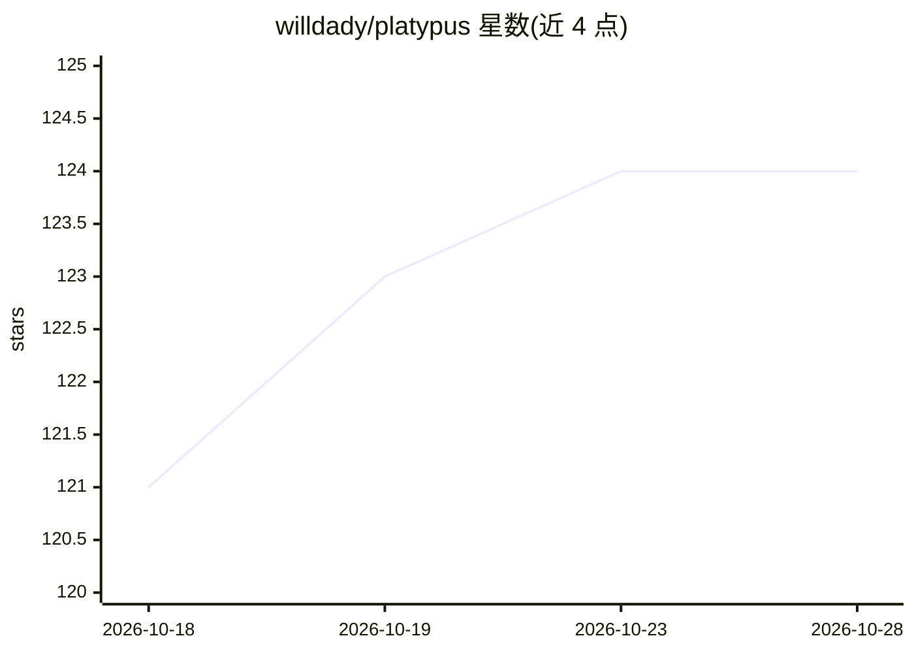

# willdady/platypus

⭐ 124 · TypeScript · MIT · 推送 2026-10-27 · [GitHub](https://github.com/willdady/platypus) · [官网](https://platypus.chat) · 组织维护

**团队自托管的 AI Agent 平台：自备模型构建、运行常驻 Agent**

MIT 许可的全栈开源应用，供团队在自己基础设施上构建和运行 AI Agent：支持自选模型（本地或前沿模型），提供 Agent/Skill/子 Agent 构建、MCP 与 A2A 接入、cron 触发器、隔离沙箱、记忆抽取、看板与仪表盘、通知与 Webhook、组织/工作区多租户隔离，并通过插件 SDK 扩展。基于 Vercel AI SDK，支持 OpenAI/Anthropic/Google/Bedrock/OpenRouter 及 Ollama、vLLM 等。Docker Compose 一键安装，需 Linux/macOS（Windows 经 WSL）与 Docker；登录仅支持邮箱密码，无 SSO/OIDC/SAML。

## 筛选速览

| 维度 | 判定 | 备注 |
|---|---|---|
| AI 角色 | `ai-ecosystem` | LLM/agent 周边工具 |
| 许可风险 | `permissive` | MIT |
| 部署形态 | `self-host` | docker 或自建部署 |
| 模型依赖 | local-ok | 支持本地模型 |
| 硬件要求 | — | 无带数字的原话,不猜 |
| 安装摩擦 | `low` | 无编译、无系统依赖或容器化 |
| 成熟度 | — | 结构信号不足 |

## 能力要点

- Agent 可通过内置工具操作看板、仪表盘、触发器并读写网页
- 一等公民的 MCP 支持与开放 A2A 协议端点（按客户端发 token）
- 触发器支持 cron、一次性及工作区事件驱动，服务端持续运行
- 组织与工作区多租户数据隔离，插件 SDK 免 fork 扩展

## 适用场景

- 团队在自有基础设施上运行 7x24 常驻 AI Agent
- 内部数据不出境，对接本地 Ollama/vLLM 模型
- 用看板和仪表盘让 Agent 参与团队工作流自动化
- 通过 A2A 端点把 Agent 暴露给外部聊天平台或其他 agent

## 场景标签

`Agent 框架` `工作流自动化` · 领域:Agent 开发

## 证据(README 行号)

> L13: Platypus is an open-source, full-stack application for building AI Agents that reason, use tools, and keep working 
> L41: - **🌐 Provider Agnostic:** Powered by the Vercel AI SDK — OpenAI, Anthropic, Google, Bedrock, and OpenRouter, plus 
> L52: curl -fsSL https://platypus.chat/install.sh | ADMIN_EMAIL=you@example.com bash

## 星数曲线

2026-10-18 121 → 2026-10-28 124（+3）

---
*卡片 v1 · prompt 1.4 · 生成 2026-10-23 · 置信度 high · 依据 README sha `74ffae71cd4d` · [字段定义](../../DATASET.md)*
