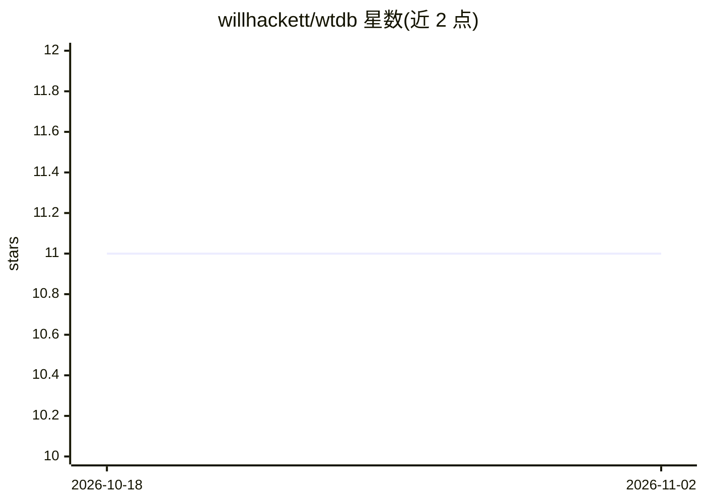

# willhackett/wtdb

⭐ 11 · Go · MIT · 推送 2026-10-10 · [GitHub](https://github.com/willhackett/wtdb) · [官网](https://willhackett.com/wtdb) · 个人维护

**为每个 git worktree 自动分配独立数据库的开发者工具**

解决 git worktree 多分支共用同一本地开发数据库导致的迁移冲突问题。创建 worktree 时自动：用 PostgreSQL TEMPLATE 方式复制开发数据库并按 worktree 命名；复制 .env/.dev.vars 等环境文件并改写数据库 URL；用 copy-on-write 克隆 node_modules 等 gitignore 路径。通过 post-checkout git hook 触发，附带 prune 清理孤立数据库、sync/status 等命令。仅内置 PostgreSQL 适配器，其他数据库需自行实现接口注册。curl 脚本安装。README 未描述 AI 相关功能。

## 筛选速览

| 维度 | 判定 | 备注 |
|---|---|---|
| AI 角色 | `ai-enhanced` | 去掉 AI 部分产品仍成立 |
| 许可风险 | `permissive` | MIT |
| 部署形态 | `None` |  |
| 模型依赖 | — | README 未给出锁定关系 |
| 硬件要求 | — | 无带数字的原话,不猜 |
| 安装摩擦 | `low` | 无编译、无系统依赖或容器化 |
| 成熟度 | — | 结构信号不足 |

## 能力要点

- 创建 worktree 时以 TEMPLATE 方式近即时复制 Postgres 数据库
- 复制并改写 env 文件中的数据库连接 URL
- copy-on-write 方式克隆 node_modules 等 gitignore 路径
- wtdb prune 清理已删除 worktree 的数据库

## 适用场景

- 多分支并行开发时避免数据库迁移互相踩踏
- 新建 worktree 后无需手动复制 .env 与 node_modules 即可运行
- 回收已删除 worktree 遗留的数据库

## 场景标签

 · 领域:开发者工具/版本控制

## 证据(README 行号)

> L62: git worktree add ../myapp-feature

## 星数曲线

2026-10-18 11 → 2026-11-02 11（+0）

---
*卡片 v1 · prompt 1.4 · 生成 2026-11-01 · 置信度 low · 依据 README sha `27478b80e92c` · [字段定义](../../DATASET.md)*
