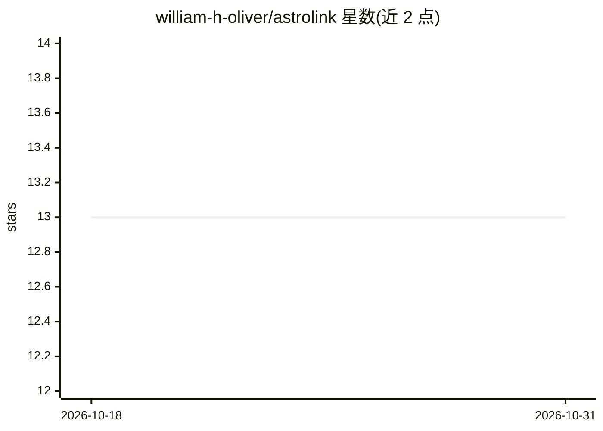

# william-h-oliver/astrolink

⭐ 13 · Python · MIT · 推送 2026-10-03 · [GitHub](https://github.com/william-h-oliver/astrolink) · [官网](https://astrolink.readthedocs.io/) · 个人维护

**面向天体物理点云数据的层次聚类算法库**

AstroLink 是一个通用聚类算法 Python 包，针对天体物理数据集提取有意义的层次结构，能从任意形状的数据集中找出任意数量、任意形状的簇及其在整体层级中的结构关系；簇被定义为相对周围环境及噪声密度涨落统计显著的超密度区域。多数情况下无需调参即可应用，参数量少且直观。输入为 np.ndarray（n_samples, d_features），提供密度场可视化、有序密度图与簇成员提取；可从 PyPI 或 conda-forge 安装。

## 筛选速览

| 维度 | 判定 | 备注 |
|---|---|---|
| AI 角色 | `ai-native` | 本体是模型或模型工具 |
| 许可风险 | `permissive` | MIT |
| 部署形态 | `library` | 以包/库形式分发 |
| 模型依赖 | — | README 未给出锁定关系 |
| 硬件要求 | — | 无带数字的原话,不猜 |
| 安装摩擦 | `low` | 无编译、无系统依赖或容器化 |
| 成熟度 | — | 结构信号不足 |

## 能力要点

- 从点云数据提取层次聚类结构，簇为统计显著超密度区域
- 多数场景无需调参，可发现任意数量与形状的簇
- 提供密度场与有序密度图可视化及簇成员提取
- 返回覆盖全数据的根簇，支持以模块化方式重复应用于不相交数据集

## 适用场景

- 在天体物理模拟或观测点云中识别有物理意义的成团结构
- 对任意点云数据做无需调参的层次聚类分析
- 可视化数据的密度场估计与聚类层级结构

## 场景标签

 · 领域:天体物理/数据分析

## 证据(README 行号)

> L12: AstroLink is a general purpose clustering algorithm built for extracting meaningful hierarchical structure from ast
> L32: AstroLink can be easily applied to any point-based input data expressed as a `np.ndarray` with shape `(n_samples, d

## 星数曲线

2026-10-18 13 → 2026-10-31 13（+0）

---
*卡片 v1 · prompt 1.4 · 生成 2026-10-31 · 置信度 high · 依据 README sha `a529092e10e6` · [字段定义](../../DATASET.md)*
