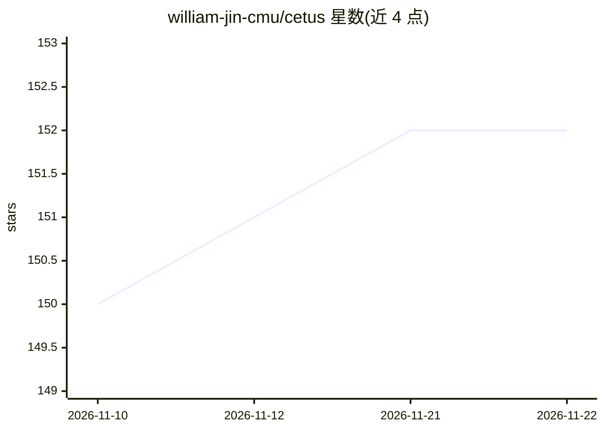

# william-jin-cmu/cetus

⭐ 152 · TypeScript · MIT · 推送 2026-11-20 · [GitHub](https://github.com/william-jin-cmu/cetus) · [官网](https://cetus.run) · 个人维护 · 中文 README

**macOS 桌面客户端：统一管理 Claude Code、Codex 等多个 agent 运行时**

面向使用多个 coding agent 的用户的 macOS 桌面应用：在单一窗口中接入 Claude Code、Codex、DeepSeek Harness、OpenCode、Grok Build、Kimi CLI、Antigravity 等已安装并登录的 CLI 运行时（复用其登录与模型配置），将权限确认、提问、计划以卡片形式集中呈现，并提供按对话的 git worktree 并行编辑、全局热键快速启动、定时任务、iPhone 远程伴侣应用、屏幕上下文与会议记录等能力。内置运行时支持 30+ 模型提供方。要求 Apple Silicon Mac 与 macOS 13+，自声明为早期版本。

## 筛选速览

| 维度 | 判定 | 备注 |
|---|---|---|
| AI 角色 | `ai-ecosystem` | LLM/agent 周边工具 |
| 许可风险 | `permissive` | MIT |
| 部署形态 | `desktop` | 安装包/桌面程序 |
| 模型依赖 | — | README 未给出锁定关系 |
| 硬件要求 | — | 无带数字的原话,不猜 |
| 安装摩擦 | `low` | 无编译、无系统依赖或容器化 |
| 成熟度 | `idea` | |

## 能力要点

- 单一窗口接入 7 种外部 CLI 运行时并复用其登录状态
- 按对话的 git worktree 支持多 agent 并行编辑同一仓库
- at/every/cron/daily 定时任务，运行结果汇入统一评审看板
- iPhone 伴侣应用经端到端加密中继远程审批与对话

## 适用场景

- 同时使用多个 coding agent CLI 时统一接收权限确认与评审完成工作
- 把同一条提示扇出为多个候选运行并保留其一
- 在手机上审批 git push 或回答 agent 的提问

## 场景标签

`编码 Agent` · 领域:编码与开发

## 证据(README 行号)

> L5:  Cetus is a desktop client for reviewing and managing the work of every agent you run — Claude Code, Codex, DeepSeek
> L37: - **Every runtime in one window.** Use the CLI you already have installed and signed in to. Cetus reuses its login,

## 星数曲线

2026-11-10 150 → 2026-11-22 152（+2）

---
*卡片 v1 · prompt 1.4 · 生成 2026-11-17 · 置信度 high · 依据 README sha `49b9369dea5f` · [字段定义](../../DATASET.md)*
