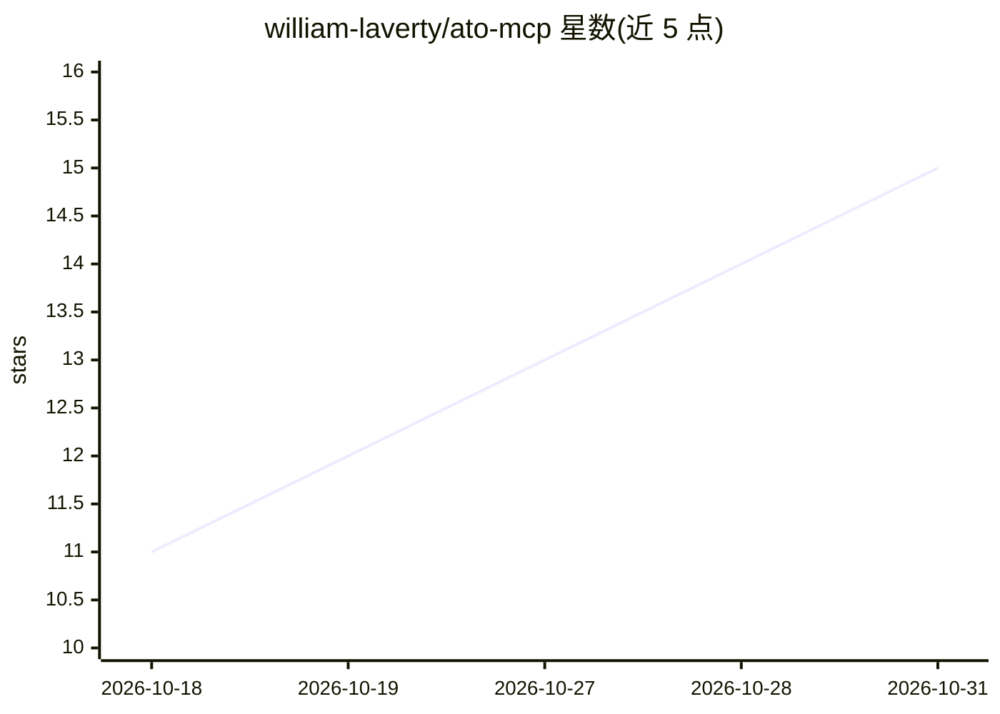

# william-laverty/ato-mcp

⭐ 15 · TypeScript · AGPL-3.0 · 推送 2026-10-27 · [GitHub](https://github.com/william-laverty/ato-mcp) · [官网](https://ato-mcp.com.au) · 个人维护

**连接 AI agent 与澳大利亚税务知识库的 MCP 服务器**

面向 AI agent 的澳大利亚税务知识 MCP 服务器：索引 34,500+ 份 ATO 文档（guidance、ITAA 1997/1936 与 GST 法案、4,900+ 公共裁定、64,217 条交叉引用、时点阈值），月度刷新，通过托管平台提供 13 个工具，包括扣除发现、折旧计算、BAS 清单、审计风险检查等 workflow 工具及检索/定义/阈值查询。所有工具返回结构化数据与可解析 ATO 引用。支持 npx/npm 安装或远程 HTTP 连接，兼容 Claude Code、Codex CLI、Gemini CLI、VS Code、Cursor、ChatGPT 等客户端。声明为信息基础设施而非税务建议；npm 包为 AGPL-3.0，托管平台与语料为专有，可申请商业许可。

## 筛选速览

| 维度 | 判定 | 备注 |
|---|---|---|
| AI 角色 | `ai-ecosystem` | LLM/agent 周边工具 |
| 许可风险 | `viral` | AGPL-3.0 |
| 部署形态 | `library` | 以包/库形式分发 |
| 模型依赖 | locked-api |  |
| 硬件要求 | — | 无带数字的原话,不猜 |
| 安装摩擦 | `low` | 无编译、无系统依赖或容器化 |
| 成熟度 | — | 结构信号不足 |

## 能力要点

- 34,500+ ATO 文档（286,000+ 可检索段落）月度刷新
- 13 个工具：扣除发现、折旧表、BAS 清单、审计风险检查与检索查询
- workflow 工具返回结构化数据与可解析 ATO 引用
- onboarding 采集 25 项个人事实避免 agent 重复询问

## 适用场景

- 让 Claude/Cursor 等 AI agent 引用 ATO 原文回答我的澳洲税务问题
- 根据我的收入结构发现可申报的扣除类别并计算折旧
- 报税草稿的审计风险模式检查

## 场景标签

`RAG` `文档问答` · 领域:知识与检索

## 证据(README 行号)

> L5: Connect your AI agent to 34,500+ ATO documents (guidance, legislation, and
> L20: **Standard config** works with most tools that run stdio servers:
> L30: npm install -g ato-mcp   # optional, npx works without installing

## 星数曲线

2026-10-18 11 → 2026-10-31 15（+4）

---
*卡片 v1 · prompt 1.4 · 生成 2026-10-30 · 置信度 high · 依据 README sha `ad4214ebe8b9` · [字段定义](../../DATASET.md)*
