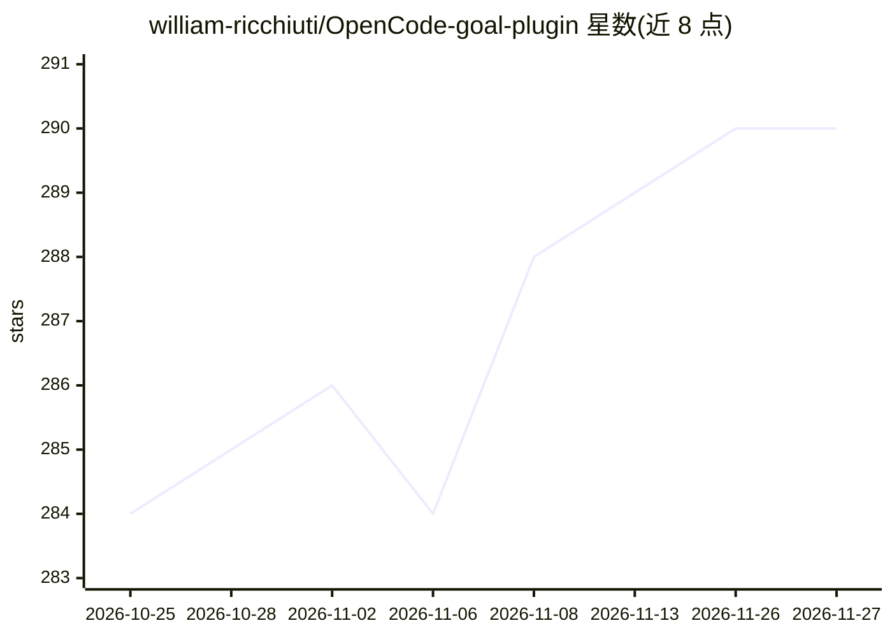

# william-ricchiuti/OpenCode-goal-plugin

⭐ 290 · JavaScript · MIT · 推送 2026-11-02 · [GitHub](https://github.com/william-ricchiuti/OpenCode-goal-plugin) · [官网](https://www.npmjs.com/package/opencode-goal-plugin) · 个人维护

**OpenCode 的 /goal 插件：让 agent 持续运行直到证实目标完成**

为 OpenCode 提供会话级 /goal 命令的插件：设定目标后 agent 自动持续运行，需通过独立只读子会话审核员（default-deny，仅 read/glob/grep）批准证据性完成声明后归档，否则默认拒绝。支持多目标与有序序列、轮次/时间/令牌/成本限额、fail-closed 持久化（原子写入、追加式生命周期账本、每会话租约）。同时兼容 OpenCode 1 与 2，经 npm 由 OpenCode 自行加载。注意：OpenCode 2.2.1+ 已内置 /goal，本项目仅维护，不再新增功能。

## 筛选速览

| 维度 | 判定 | 备注 |
|---|---|---|
| AI 角色 | `ai-ecosystem` | LLM/agent 周边工具 |
| 许可风险 | `permissive` | MIT |
| 部署形态 | `library` | 以包/库形式分发 |
| 模型依赖 | — | README 未给出锁定关系 |
| 硬件要求 | — | 无带数字的原话,不猜 |
| 安装摩擦 | `low` | 无编译、无系统依赖或容器化 |
| 成熟度 | — | 结构信号不足 |

## 能力要点

- 独立只读验证子会话，完成声明默认拒绝，需 [audit:approved]
- fail-closed 持久化：原子写入、追加式生命周期账本、每会话租约
- 支持多目标队列与有序序列，可配置轮次/分钟/令牌/成本限额
- 94 项命名回归的变异测试契约（npm run test:mutation）

## 适用场景

- 让 OpenCode agent 无人值守长时间运行直至目标有证据地完成
- 修复失败测试套件并验证通过（demo 提供示例）
- 需要对目标完成做证据门控审核、防止模型虚报完成的场景
- 多目标按序自动推进的批量任务

## 场景标签

`编码 Agent` · 领域:编码与开发

## 证据(README 行号)

> L7: A `/goal` command for OpenCode: set an objective, walk away, and the plugin keeps the agent working until it proves 
> L17: - **Independent verifier.** A goal is archived only after a separate child session, default-deny with `read`, `glob
> L20: - **One core, two hosts.** OpenCode 1 and OpenCode 2 load the same entrypoint; `src/v2-bridge.js` adapts OpenCode 2

## 星数曲线

2026-10-25 284 → 2026-11-27 290（+6）

---
*卡片 v1 · prompt 1.4 · 生成 2026-11-25 · 置信度 high · 依据 README sha `c517266832ff` · [字段定义](../../DATASET.md)*
