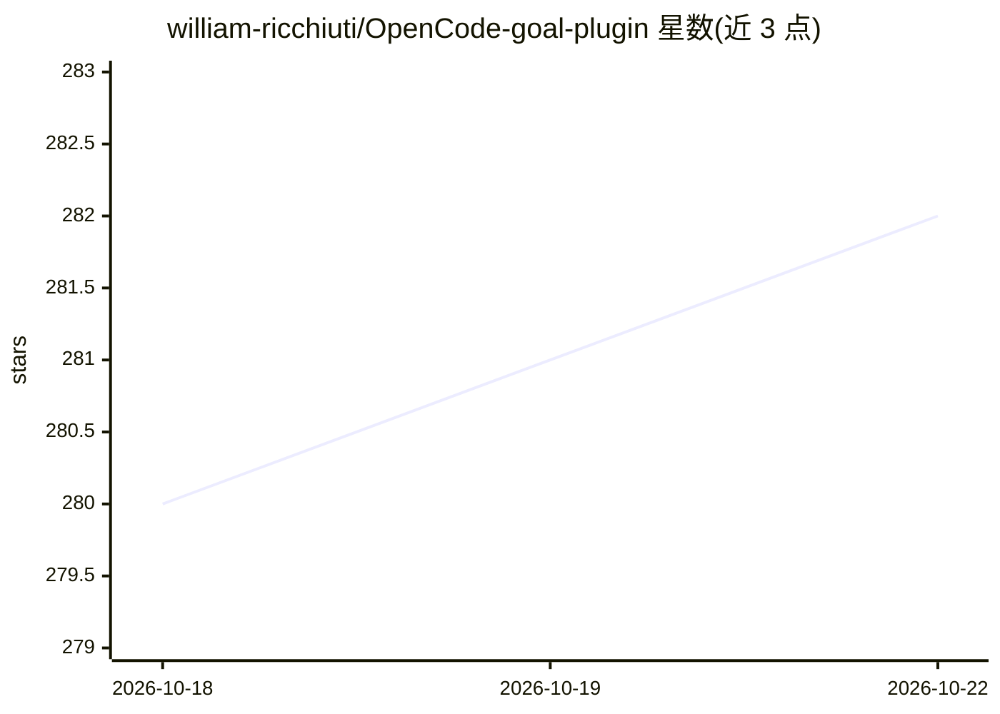

# william-ricchiuti/OpenCode-goal-plugin

⭐ 283 · JavaScript · MIT · 推送 2026-10-19 · [GitHub](https://github.com/william-ricchiuti/OpenCode-goal-plugin) · [官网](https://www.npmjs.com/package/opencode-goal-plugin) · 个人维护

**OpenCode 插件：为会话设定受守护的持久目标工作流**

面向 OpenCode 的 npm 插件，提供会话级 /goal 命令：设定目标后跨轮次与压缩保持上下文，助手空闲时自动续跑，并在目标完成、报告阻塞或触达安全限制（轮次/时长/token/无进展/无工具调用）时停止。支持项目本地持久化与重启恢复、证据门控完成（可选独立 fail-closed 验证器）、多目标与有序目标序列。依赖 OpenCode 实验 hooks，需按所用版本钉死插件版本并自行重测。

## 筛选速览

| 维度 | 判定 | 备注 |
|---|---|---|
| AI 角色 | `ai-ecosystem` | LLM/agent 周边工具 |
| 许可风险 | `permissive` | MIT |
| 部署形态 | `library` | 以包/库形式分发 |
| 模型依赖 | — | README 未给出锁定关系 |
| 硬件要求 | — | 无带数字的原话,不猜 |
| 安装摩擦 | `low` | 无编译、无系统依赖或容器化 |
| 成熟度 | `idea` | |

## 能力要点

- 轮次/时长/token/无进展等多重安全限制的守护式自动续跑
- 持久化状态与有界生命周期账本支持重启恢复
- 证据门控完成，可选独立 fail-closed 验证器
- active/paused/blocked 生命周期与多目标、有序序列

## 适用场景

- 让 OpenCode 会话长时间自主推进一个目标并在完成后自动停止
- 为无人值守任务设置 token/费用等安全上限
- 需要完成证据与独立验证的多步开发目标

## 场景标签

 · 领域:AI 编码助手/agent 工具链

## 证据(README 行号)

> L9: A session-scoped `/goal` workflow for OpenCode.
> L11: Set a goal and the plugin keeps it in context, auto-continues the session whenever the assistant goes idle, and sto

## 星数曲线

2026-10-18 280 → 2026-10-22 282（+2）

---
*卡片 v1 · prompt 1.4 · 生成 2026-10-22 · 置信度 high · 依据 README sha `68920f07e4db` · [字段定义](../../DATASET.md)*
