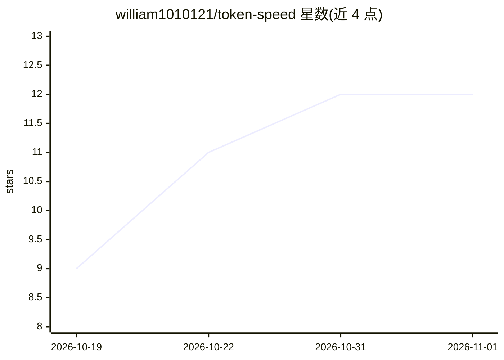

# william1010121/token-speed

⭐ 12 · Rust · MIT · 推送 2026-10-21 · [GitHub](https://github.com/william1010121/token-speed) · 个人维护 · 中文 README

**Codex 与 Claude Code 的 token 吞吐量终端观测工具**

用 Rust/ratatui 编写的本地 TUI，读取 Codex 与 Claude Code 在本机的会话日志（JSONL），构建增量 SQLite 索引，在 Overview、Timeline、Models、Requests 四个视图中展示估算吞吐量、P50/P90、速率分布、上下文大小散点与请求台账。区分缺失活动与缺失计时，不做插值；支持 table/JSON/CSV 脚本化报告。无需 API key，不做模型调用或遥测；不存储提示词或工具输出体。提供 npm 预编译包（macOS/Linux）、cargo 安装与源码构建，不提供 Windows 版。

## 筛选速览

| 维度 | 判定 | 备注 |
|---|---|---|
| AI 角色 | `ai-ecosystem` | LLM/agent 周边工具 |
| 许可风险 | `permissive` | MIT |
| 部署形态 | `library` | 以包/库形式分发 |
| 模型依赖 | — | README 未给出锁定关系 |
| 硬件要求 | — | 无带数字的原话,不猜 |
| 安装摩擦 | `low` | 无编译、无系统依赖或容器化 |
| 成熟度 | — | 结构信号不足 |

## 能力要点

- 四视图（Overview/Timeline/Models/Requests）联动并保留过滤条件
- tok/s 为基于日志时间戳的估算吞吐，缺失计时有独立标识
- 本地 SQLite 增量索引，无 API key、无遥测
- table/JSON/CSV 报告模式可嵌入脚本

## 适用场景

- 查看编码 agent 何时活跃、哪些模型在我的负载中更快
- 按模型/会话过滤排查需要关注的请求
- 在终端中监控 Codex 与 Claude Code 的 token 用量与吞吐

## 场景标签

`LLM 可观测性` · 领域:评测与运维

## 证据(README 行号)

> L5: A terminal observatory for Codex and Claude Code.
> L22: You already have usage logs. See when your agents were active, which models were faster in your workload, and which
> L27: - **Local by default:** no API keys, model calls or telemetry. An incremental SQLite index keeps subsequent reads f

## 星数曲线

2026-10-19 9 → 2026-11-01 12（+3）

---
*卡片 v1 · prompt 1.4 · 生成 2026-10-31 · 置信度 high · 依据 README sha `e9ca9bccba36` · [字段定义](../../DATASET.md)*
