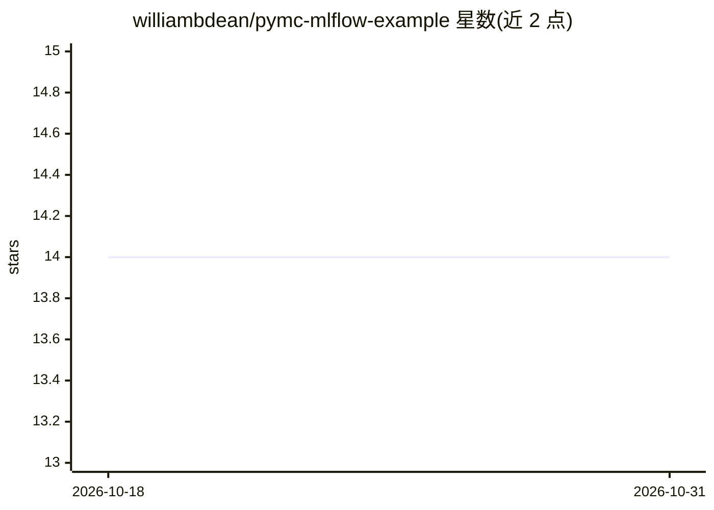

# williambdean/pymc-mlflow-example

⭐ 14 · Python · 推送 2026-08-14 · [GitHub](https://github.com/williambdean/pymc-mlflow-example) · 个人维护

**PyMC 贝叶斯建模接入 MLflow 实验追踪的示例集合**

一组演示如何将 PyMC 与 pymc_marketing.mlflow 模块结合、向 MLflow 记录参数/指标/产物的示例脚本：包含非 PyMC 基础日志、PyMC 指标记录、pymc_marketing 自动日志、以及 Marketing Mix Model 网格拟合四个脚本，可批量或单脚本运行，共产生约 20 个 MLflow run。环境用 pixi 管理并提供多平台 lockfile；MLflow 服务端用本地 SQLite 存储与 UI 浏览，配套 make serve/prune/clean_up 等沙箱命令。面向使用 PyMC 做贝叶斯建模并需要实验追踪的用户。

## 筛选速览

| 维度 | 判定 | 备注 |
|---|---|---|
| AI 角色 | `ai-ecosystem` | LLM/agent 周边工具 |
| 许可风险 | `none` | — |
| 部署形态 | `None` |  |
| 模型依赖 | — | README 未给出锁定关系 |
| 硬件要求 | — | 无带数字的原话,不猜 |
| 安装摩擦 | `low` | 无编译、无系统依赖或容器化 |
| 成熟度 | — | 结构信号不足 |

## 能力要点

- 四个示例脚本覆盖基础日志到 MMM 自动日志
- pymc_marketing.mlflow 自动日志与 Marketing Mix Model 网格拟合
- pixi 管理环境与多平台 lockfile
- make serve/prune/clean_up 提供 MLflow 服务器与沙箱清理流程

## 适用场景

- 学习如何把 PyMC 实验记录到 MLflow
- 参考 MMM 多模型网格实验的追踪写法
- 搭建本地 MLflow 追踪沙箱并浏览/清理 run

## 场景标签

`MLOps` `教程课程` · 领域:学习与行业

## 证据(README 行号)

> L3: These are simple examples of using PyMC with MLflow, taking advantage of the
> L6: This focuses on logging parameters, metrics, and artifacts to MLflow.

## 星数曲线

2026-10-18 14 → 2026-10-31 14（+0）

---
*卡片 v1 · prompt 1.4 · 生成 2026-10-31 · 置信度 high · 依据 README sha `de4f9a680dea` · [字段定义](../../DATASET.md)*
