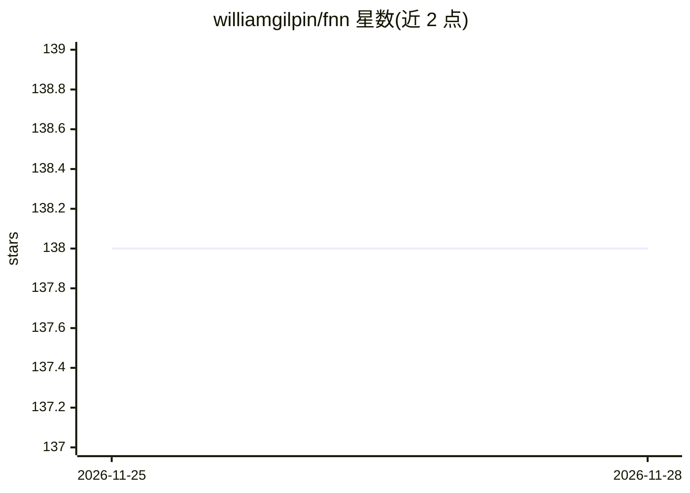

# williamgilpin/fnn

⭐ 138 · Jupyter Notebook · 推送 2026-11-23 · [GitHub](https://github.com/williamgilpin/fnn) · 个人维护

**为科研人员提供基于 FNN 正则化的时间序列相空间嵌入工具**

面向低维时间序列的相空间重建库：用受假最近邻方法启发的正则项训练自编码器/MLP/LSTM，从时间序列学习描述混沌动力学的高维嵌入，同时实现平均互信息、ETD、tICA 等标准嵌入方法作为对照。模型遵循 scikit-learn API，正则器可直接注入现有 PyTorch 模型。要求 Python 3.10+ 与 PyTorch 2.0+，通过 uv 从源码安装，附带 Lorenz、双摆、ECG 等演示笔记本与测试数据集。

## 筛选速览

| 维度 | 判定 | 备注 |
|---|---|---|
| AI 角色 | `ai-native` | 本体是模型或模型工具 |
| 许可风险 | `none` | — |
| 部署形态 | `None` |  |
| 模型依赖 | — | README 未给出锁定关系 |
| 硬件要求 | — | 无带数字的原话,不猜 |
| 安装摩擦 | `low` | 无编译、无系统依赖或容器化 |
| 成熟度 | — | 结构信号不足 |

## 能力要点

- FNN 正则器可直接作为损失项加入任意 PyTorch 模型（loss_false）
- 同时提供 AMI、ETD、tICA 等传统嵌入方法实现
- 模型遵循 scikit-learn API，附带内嵌时间序列数据集与教程笔记本

## 适用场景

- 对混沌系统观测数据做相空间重构
- 为论文实验对比多种时间序列嵌入方法
- 将 FNN 正则项接入自己的 PyTorch 自编码器

## 场景标签

`科研工具` · 领域:学习与行业

## 证据(README 行号)

> L9: Given a one-dimensional or few-dimensional time series, this package uses the time history of the system to find add
> L11: This package implements standard time series embedding techniques originally developed for embedding strange attrac

## 星数曲线

2026-11-25 138 → 2026-11-28 138（+0）

---
*卡片 v1 · prompt 1.4 · 生成 2026-11-24 · 置信度 high · 依据 README sha `15562be2193e` · [字段定义](../../DATASET.md)*
