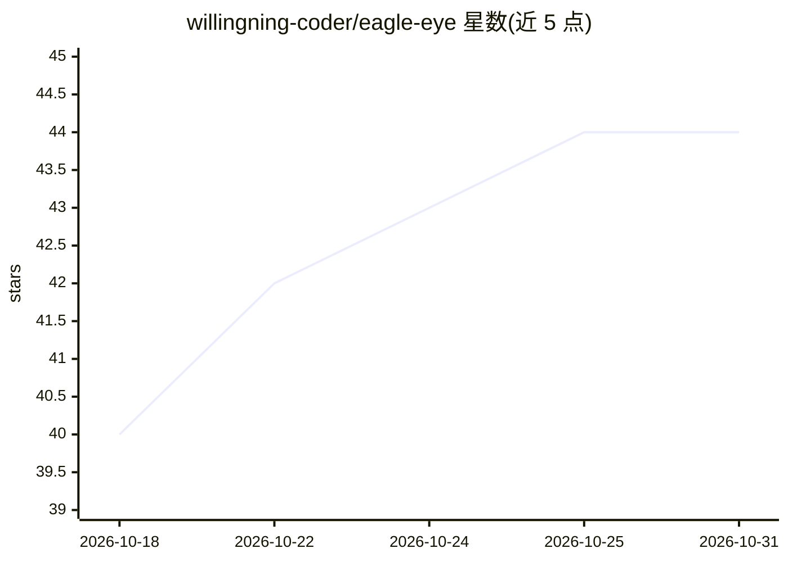

# willingning-coder/eagle-eye

⭐ 44 · Python · MIT · 推送 2026-06-01 · [GitHub](https://github.com/willingning-coder/eagle-eye) · 个人维护 · 中文 README

**Hermes Agent 的五层技能检索插件，将百级技能筛为前 5**

面向 Hermes Agent 的零侵入插件：Agent 安装技能过多时，技能全量注入系统提示导致选错技能、每轮消耗 5,000–10,000 token。Eagle Eye 在每次 API 调用前做预过滤，经硬触发词、FTS5 检索、同义词典、稠密嵌入与 RRF 融合五层，把候选缩至前 5 并以提示形式注入，LLM 保留最终裁决权。各层独立降级：缺少 sentence-transformers 或 jieba 时仍可运行子集。默认嵌入模型为中文 text2vec，中文分词依赖 jieba。通过 git clone 源码安装，配置可由脚本或 LLM 辅助生成。

## 筛选速览

| 维度 | 判定 | 备注 |
|---|---|---|
| AI 角色 | `ai-ecosystem` | LLM/agent 周边工具 |
| 许可风险 | `permissive` | MIT |
| 部署形态 | `None` |  |
| 模型依赖 | — | README 未给出锁定关系 |
| 硬件要求 | — | 无带数字的原话,不猜 |
| 安装摩擦 | `low` | 无编译、无系统依赖或容器化 |
| 成熟度 | — | 结构信号不足 |

## 能力要点

- 五层检索：硬触发词/FTS5/同义词典/稠密嵌入/RRF 融合，零核心修改
- 置信度门控允许不匹配任何技能，避免强制匹配
- 各依赖层独立降级，缺失 sentence-transformers 或 jieba 不崩溃
- 提供配置自动生成脚本与 LLM 辅助生成提示词

## 适用场景

- Agent 技能数量多时按查询动态筛选最相关技能
- 降低技能列表带来的每轮 token 消耗
- 通过环境变量调整返回技能数、切换嵌入模型或整体禁用

## 场景标签

`Agent 框架` · 领域:Agent 开发

## 证据(README 行号)

> L1: # 🦅 Eagle Eye — 5-Layer Intelligent Skill Retrieval for Hermes Agent
> L17: Eagle Eye is a **zero-invasive plugin** that acts as an intelligent pre-filter. Before each API call, it narrows th

## 星数曲线

2026-10-18 40 → 2026-10-31 44（+4）

---
*卡片 v1 · prompt 1.4 · 生成 2026-10-25 · 置信度 high · 依据 README sha `4b7eff6b1e35` · [字段定义](../../DATASET.md)*
