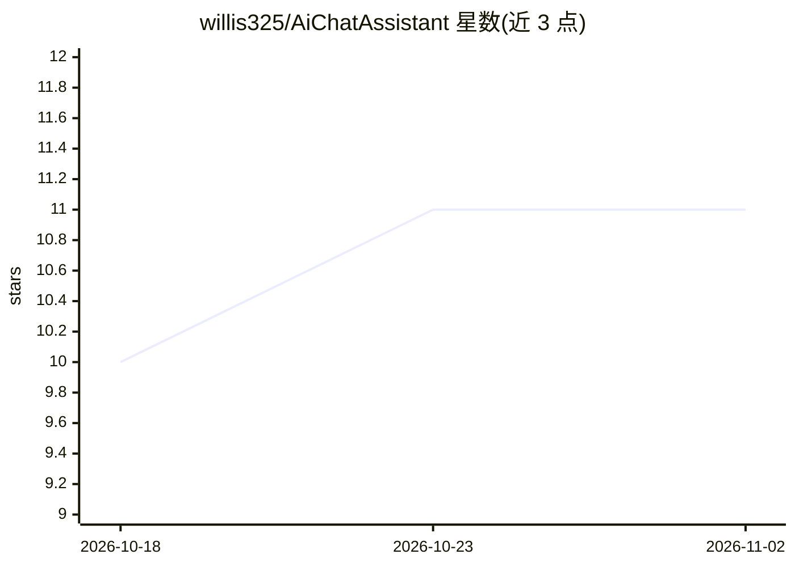

# willis325/AiChatAssistant

⭐ 11 · TypeScript · MIT · 推送 2025-12-10 · [GitHub](https://github.com/willis325/AiChatAssistant) · [官网](https://ai-chat-assistant-willis.vercel.app) · 个人维护 · 中文 README

**给 AI 重度用户的浏览器插件：为长对话生成目录导航**

轻量级浏览器扩展，面向在 ChatGPT、DeepSeek、Gemini、Kimi、通义千问、豆包、腾讯元宝等平台进行长对话的用户。插件自动识别对话中的用户提问，在页面右侧生成悬浮目录侧边栏，点击即可跳转到对应位置。所有解析在本地浏览器完成，不收集或上传对话内容，仅在支持的 AI 网站域名上激活。通过 Chrome 插件商店安装，或以开发者模式加载解压源码。

## 筛选速览

| 维度 | 判定 | 备注 |
|---|---|---|
| AI 角色 | `ai-ecosystem` | LLM/agent 周边工具 |
| 许可风险 | `permissive` | MIT |
| 部署形态 | `None` |  |
| 模型依赖 | — | README 未给出锁定关系 |
| 硬件要求 | — | 无带数字的原话,不猜 |
| 安装摩擦 | `low` | 无编译、无系统依赖或容器化 |
| 成熟度 | — | 结构信号不足 |

## 能力要点

- 自动提取用户提问生成可点击的目录侧边栏
- 单个扩展覆盖 7 个主流 AI 对话平台
- 全部解析在本地浏览器完成，无数据上传
- 仅在支持平台的特定 URL 上激活运行

## 适用场景

- 长对话中快速跳转回某个提问及其上下文
- 在多个 AI 平台间用同一插件获得目录导航
- 需要本地处理、不上传对话内容的场景

## 场景标签

 · 领域:开发者工具/浏览器扩展

## 证据(README 行号)

> L16: **AiChatAssistant** is a lightweight, privacy-focused browser extension designed to enhance your experience with LL
> L61: **AiChatAssistant** 是一款专为重度 AI 用户设计的浏览器插件。它能在这一款插件中同时支持 ChatGPT、DeepSeek、Kimi 等主流 AI 平台。插件会自动识别对话中的“用户提问”，并在页面右侧生成一

## 星数曲线

2026-10-18 10 → 2026-11-02 11（+1）

---
*卡片 v1 · prompt 1.4 · 生成 2026-11-01 · 置信度 high · 依据 README sha `5d7b447029e3` · [字段定义](../../DATASET.md)*
