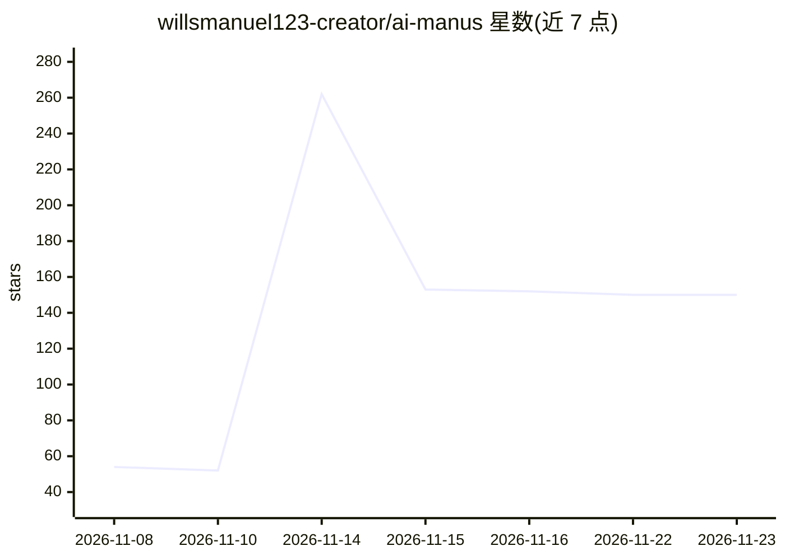

# willsmanuel123-creator/ai-manus

⭐ 150 · Python · Apache-2.0 · 推送 2026-11-08 · [GitHub](https://github.com/willsmanuel123-creator/ai-manus) · 个人维护

**面向个人用户的自主 AI 代理：代为执行代码与浏览器操作**

Manus 是一个自主 AI 代理系统，描述中称其可在沙箱环境中运行多种工具：自主执行代码、控制浏览器（导航网页、填写表单、采集信息）、执行多步骤日常任务。面向学生、远程办公者等非开发者用户，用于学习研究、家庭项目和轻量办公。README 提供硬件兼容表（最低 4GB 内存）与使用步骤说明，但未给出任何安装命令、依赖说明或代码入口；描述中的下载链接仅为'Download Manus / PROMO2026'字样，实际可用性无法从 README 验证。

## 筛选速览

| 维度 | 判定 | 备注 |
|---|---|---|
| AI 角色 | `ai-native` | 本体是模型或模型工具 |
| 许可风险 | `permissive` | Apache-2.0 |
| 部署形态 | `None` |  |
| 模型依赖 | — | README 未给出锁定关系 |
| 硬件要求 | — | 无带数字的原话,不猜 |
| 安装摩擦 | `low` | 无编译、无系统依赖或容器化 |
| 成熟度 | — | 结构信号不足 |

## 能力要点

- 描述称支持自主代码执行与浏览器控制
- 面向无需编程背景的个人用户
- README 给出最低/推荐硬件配置表

## 适用场景

- 让代理代为完成网页信息采集与表单填写
- 运行小脚本与整理研究笔记
- 处理日常重复性小任务

## 场景标签

`浏览器自动化` · 领域:效率与自动化

## 证据(README 行号)

> L18: Manus is an autonomous AI agent designed to run code and control a browser on your behalf. Instead of acting like a
> L22: Manus is not a heavy studio suite or a complex enterprise platform. It is a focused helper built for home, study, a

## 星数曲线

2026-11-08 54 → 2026-11-23 150（+96）

---
*卡片 v1 · prompt 1.4 · 生成 2026-11-17 · 置信度 low · 依据 README sha `790070d90930` · [字段定义](../../DATASET.md)*
