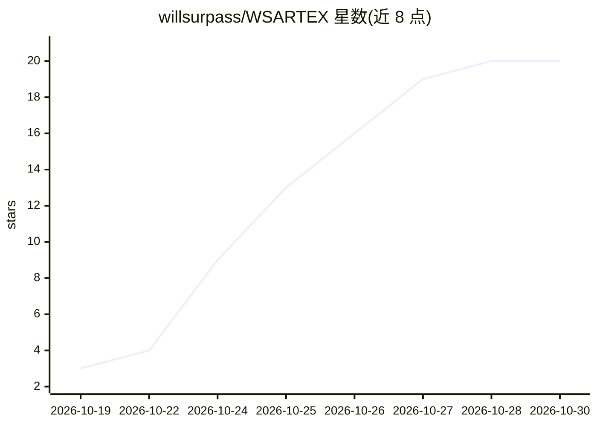

# willsurpass/WSARTEX

⭐ 20 · Go · AGPL-3.0 · 推送 2026-10-20 · [GitHub](https://github.com/willsurpass/WSARTEX) · [官网](https://willsurpass.com) · 个人维护 · 中文 README

**本地隔离环境用的 AI 自主渗透测试系统，多 Agent 协作**

基于 ARTEX 的自托管 AI 渗透测试系统，面向个人学习与本地隔离靶场技术验证。用户在面板中配置 LLM 服务商、模型与 API Key（含 Base URL），创建任务并写明目标、范围和约束后，由 AI Agent 执行资产探索与漏洞发现，任务详情中可查看执行过程、探索链路与结果。安装方式：装好 Python 后运行 start.py 按提示装依赖启动，无需手动构建前后端；quit.py 停止；数据清除不可恢复且不备份。采用 AGPL-3.0-or-later，提示实际使用须守法并取得授权。

## 筛选速览

| 维度 | 判定 | 备注 |
|---|---|---|
| AI 角色 | `ai-native` | 本体是模型或模型工具 |
| 许可风险 | `viral` | AGPL-3.0 |
| 部署形态 | `None` |  |
| 模型依赖 | — | README 未给出锁定关系 |
| 硬件要求 | — | 无带数字的原话,不猜 |
| 安装摩擦 | `low` | 无编译、无系统依赖或容器化 |
| 成熟度 | — | 结构信号不足 |

## 能力要点

- 运行 start.py 一键启动面板，无需手动构建前后端
- 面板内配置 LLM 服务商/模型/API Key/Base URL
- 任务化执行，可查看执行过程、探索链路与发现
- 本地自托管，支持一键清除全部数据

## 适用场景

- 在本地隔离靶场中验证 AI 自主渗透测试流程
- 学习多 Agent 渗透任务的组织与执行过程
- 自托管管理渗透任务资产与发现结果

## 场景标签

`网络安全` `多智能体` · 领域:Agent 开发

## 证据(README 行号)

> L3: 用于个人学习与本地隔离环境技术验证的 AI 自主渗透测试系统。原项目参考：**ARTEX**。
> L16: 2. 打开「系统 → LLM」，新建配置，填写服务商、模型、API Key，按服务需要填写 Base URL；保存后点击「设为激活」。
> L17: 3. 打开「任务」，创建任务，写明本地隔离靶场的目标、范围和约束，然后启动。

## 星数曲线

2026-10-19 3 → 2026-10-30 20（+17）

---
*卡片 v1 · prompt 1.4 · 生成 2026-10-28 · 置信度 high · 依据 README sha `063f579bc691` · [字段定义](../../DATASET.md)*
