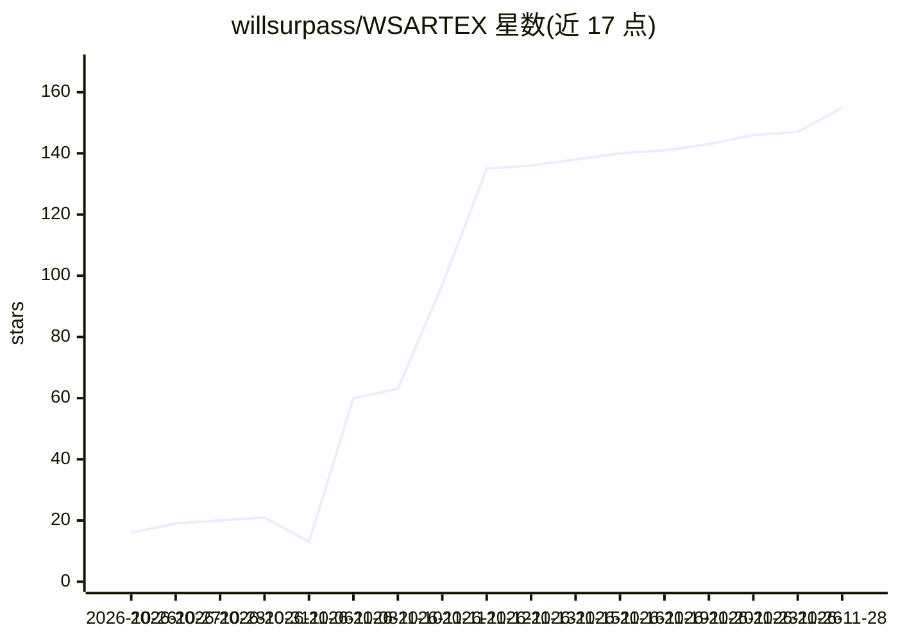

# willsurpass/WSARTEX

⭐ 155 · Go · AGPL-3.0 · 推送 2026-11-11 · [GitHub](https://github.com/willsurpass/WSARTEX) · [官网](https://willsurpass.com) · 个人维护 · 中文 README

**面向安全人员的本地部署 AI 自主渗透测试系统**

基于 ARTEX 的 AI 自主渗透测试系统，提供本地部署 Web 面板，功能涵盖多 Agent 协作、资产探索、漏洞管理与任务执行过程查看。无需 Docker，运行 start.py 按提示安装 Python 依赖即可构建前后端并启动；首次使用需设置登录密码并配置 LLM 服务商、模型与 API Key。AGPL-3.0-or-later 许可，README 建议在本地隔离靶场中学习验证，实际使用须取得授权。

## 筛选速览

| 维度 | 判定 | 备注 |
|---|---|---|
| AI 角色 | `ai-native` | 本体是模型或模型工具 |
| 许可风险 | `viral` | AGPL-3.0 |
| 部署形态 | `None` |  |
| 模型依赖 | — | README 未给出锁定关系 |
| 硬件要求 | — | 无带数字的原话,不猜 |
| 安装摩擦 | `low` | 无编译、无系统依赖或容器化 |
| 成熟度 | — | 结构信号不足 |

## 能力要点

- 多 Agent 协作执行渗透测试任务，覆盖资产探索与漏洞管理
- 本地自托管部署，无需 Docker，运行 start.py 即可启动面板
- norma 核心 SDK 源码随项目内置，配置 LLM 后即可使用
- 任务详情展示执行过程、探索链路与发现

## 适用场景

- 在本地隔离靶场中学习渗透测试流程
- 以任务形式管理目标、范围与约束并跟踪发现
- 搭建自有部署的安全测试面板并接入自有 LLM 服务

## 场景标签

`多智能体` `网络安全` · 领域:Agent 开发

## 证据(README 行号)

> L5: **开箱即用的 AI 自主渗透测试系统**
> L7: 本地部署 · 多 Agent 协作 · 资产探索 · 漏洞管理
> L34: 2. **配置 LLM** — 打开「系统 → LLM」，填写服务商、模型和 API Key，按需填写 Base URL，保存后点击「设为激活」。

## 星数曲线

2026-10-26 16 → 2026-11-28 155（+139）

---
*卡片 v1 · prompt 1.4 · 生成 2026-11-27 · 置信度 high · 依据 README sha `295ae33e6625` · [字段定义](../../DATASET.md)*
