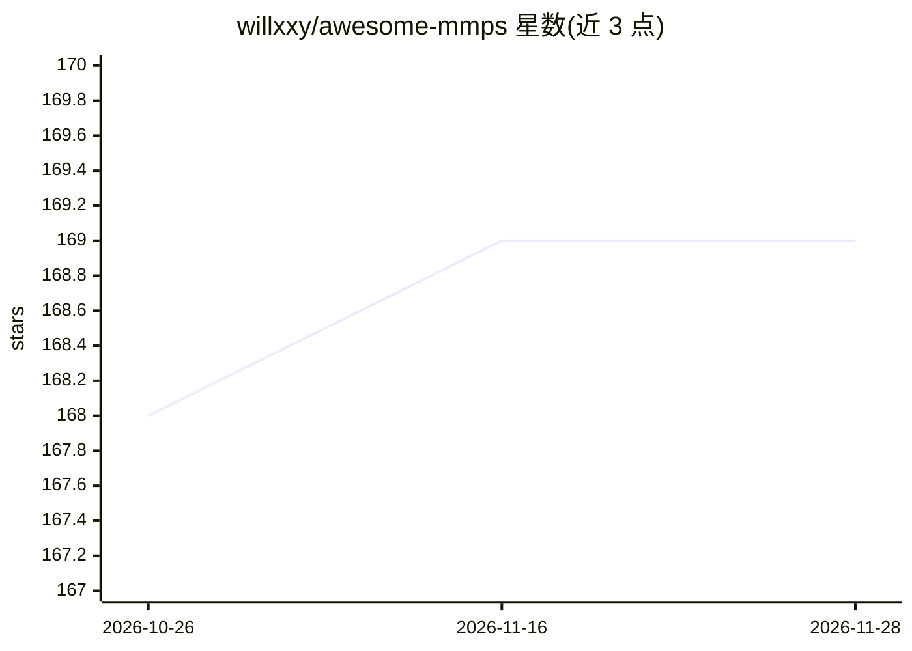

# willxxy/awesome-mmps

⭐ 169 · MIT · 推送 2026-10-30 · [GitHub](https://github.com/willxxy/awesome-mmps) · 个人维护

**生理信号多模态机器学习论文资源集**

以列表形式收录多模态机器学习结合生理信号（EEG、ECG、EOG、EMG、GSR 等）领域的研究资源，按 Publications-and-Preprints 等章节组织，条目标注发表会议/期刊与所涉信号模态组合，覆盖情绪识别、睡眠分期、语音解码、压力检测等任务方向。仓库通过 issue 接受社区补充与勘误，并附带 DOI。不包含代码、模型或安装步骤，属于文献/资源编目型仓库。

## 筛选速览

| 维度 | 判定 | 备注 |
|---|---|---|
| AI 角色 | `ai-knowledge` | 知识聚合/清单类 |
| 许可风险 | `permissive` | MIT |
| 部署形态 | `None` |  |
| 模型依赖 | — | README 未给出锁定关系 |
| 硬件要求 | — | 无带数字的原话,不猜 |
| 安装摩擦 | `low` | 无编译、无系统依赖或容器化 |
| 成熟度 | — | 结构信号不足 |

## 能力要点

- 按 EEG+X 等模态组合组织论文条目并标注来源会议/期刊
- 覆盖情绪识别、睡眠分期、EEG-to-Text、压力/抑郁检测等任务
- 通过 issue 接受社区补充与勘误

## 适用场景

- 查找生理信号多模态学习的相关论文
- 调研 EEG 与其他模态融合的研究方向
- 了解该领域基础模型与 LLM 结合的最新进展

## 场景标签

`科研工具` `多模态` `精选清单` · 领域:学习与行业

## 证据(README 行号)

> L4: Corpus of resources for multimodal machine learning with physiological signals.
> L10: ## Publications-and-Preprints

## 星数曲线

2026-10-26 168 → 2026-11-28 169（+1）

---
*卡片 v1 · prompt 1.4 · 生成 2026-11-26 · 置信度 high · 依据 README sha `a7551fca7f0f` · [字段定义](../../DATASET.md)*
