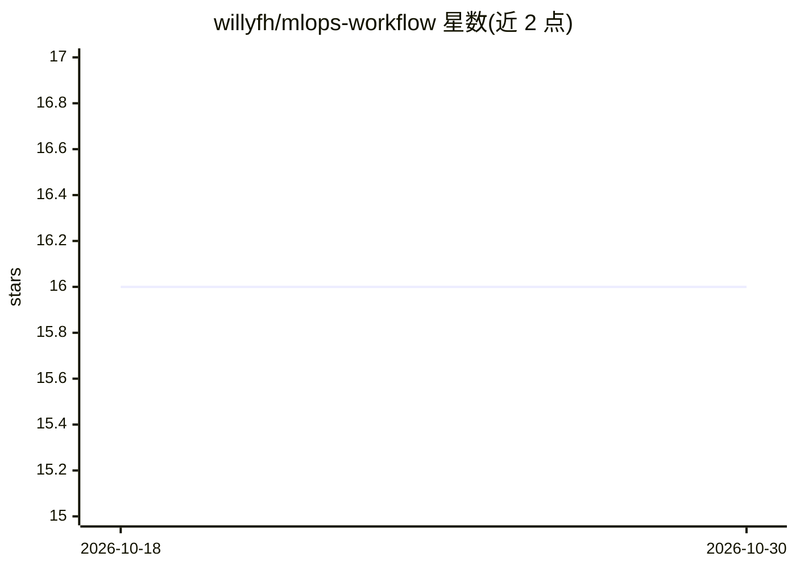

# willyfh/mlops-workflow

⭐ 16 · Python · MIT · 推送 2025-11-24 · [GitHub](https://github.com/willyfh/mlops-workflow) · 个人维护

**模块化 MLOps 工作流模板：训练、推理、实验追踪与部署**

以 FastAPI 为 API 层的机器学习运维工作流，提供并发（非阻塞）的模型训练与推理请求、MLflow 实验追踪、MinIO 构件存储、PostgreSQL 元数据存储，配置采用 Hydra 模块化管理与 Pydantic 校验，整体通过 Docker Compose 构建部署，可选启用 Nvidia container toolkit 的 GPU 支持。训练通过 curl 上传 config 文件触发，推理按 MLflow run ID 调用。作者声明这是教学用途的最小化模板/起始套件，训练逻辑保持简单，生产或科研使用需自行扩展。

## 筛选速览

| 维度 | 判定 | 备注 |
|---|---|---|
| AI 角色 | `ai-ecosystem` | LLM/agent 周边工具 |
| 许可风险 | `permissive` | MIT |
| 部署形态 | `self-host` | docker 或自建部署 |
| 模型依赖 | — | README 未给出锁定关系 |
| 硬件要求 | — | 无带数字的原话,不猜 |
| 安装摩擦 | `low` | 无编译、无系统依赖或容器化 |
| 成熟度 | — | 结构信号不足 |

## 能力要点

- FastAPI 并发处理训练与推理请求
- MLflow 实验追踪 + MinIO 构件存储 + PostgreSQL 元数据存储
- Docker Compose 一键构建部署，容器内用 uv 管理依赖
- Hydra 模块化配置与 Pydantic 校验

## 适用场景

- 作为机器学习工作流的教学或起始模板
- 搭建带实验追踪与模型注册的训练/推理服务
- 练习 GPU/CPU 可切换的容器化模型部署

## 场景标签

`MLOps` `教程课程` · 领域:学习与行业

## 证据(README 行号)

> L10: A modular MLOps workflow for training, inference, experiment tracking, model registry, and deployment.
> L17: - Supports concurrent (non-blocking) model training and inference requests via FastAPI
> L18: - MLflow for experiment tracking

## 星数曲线

2026-10-18 16 → 2026-10-30 16（+0）

---
*卡片 v1 · prompt 1.4 · 生成 2026-10-30 · 置信度 high · 依据 README sha `81ff03b82548` · [字段定义](../../DATASET.md)*
