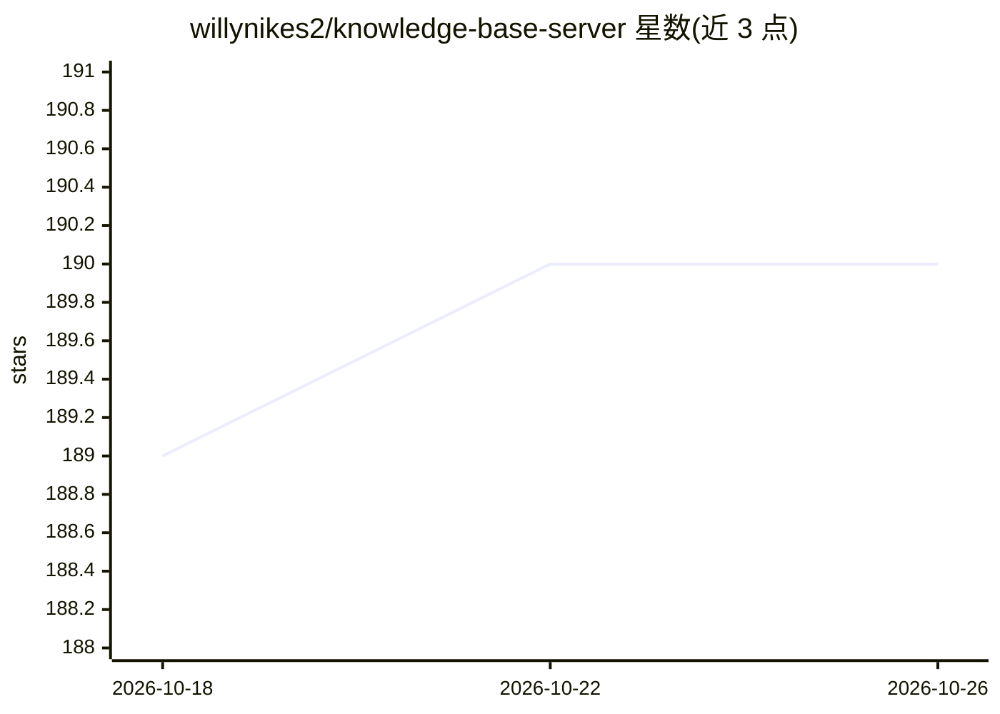

# willynikes2/knowledge-base-server

⭐ 190 · JavaScript · MIT · 推送 2026-10-14 · [GitHub](https://github.com/willynikes2/knowledge-base-server) · 个人维护

**给 AI agent 提供持久记忆的 MCP 知识库服务器**

面向多 agent 使用场景的持久记忆系统：通过 SQLite FTS5 全文检索与本地 HuggingFace 嵌入语义搜索存储知识，以 MCP（stdio/StreamableHTTP）与 REST API 供 Claude Code、Codex CLI、Gemini CLI 等多个 agent 读写同一知识库。捕获层支持 Obsidian 双向同步、YouTube 字幕、X 书签、终端会话等 20+ 文件类型；经分类、晋升、跨源综合形成三级记忆（冷/温/热）与省 token 检索（自称 90%+ 节省）。Node.js ≥18 即可运行，git clone + npm 安装，另有付费托管版 Memstalker。

## 筛选速览

| 维度 | 判定 | 备注 |
|---|---|---|
| AI 角色 | `ai-ecosystem` | LLM/agent 周边工具 |
| 许可风险 | `permissive` | MIT |
| 部署形态 | `library` | 以包/库形式分发 |
| 模型依赖 | locked-api |  |
| 硬件要求 | — | 无带数字的原话,不猜 |
| 安装摩擦 | `low` | 无编译、无系统依赖或容器化 |
| 成熟度 | — | 结构信号不足 |

## 能力要点

- SQLite FTS5 全文检索 + 本地 HuggingFace 嵌入语义/混合搜索，无需 API key
- 16 个 MCP 工具（stdio + HTTP），支持 Claude/Codex/Gemini 一键注册
- Obsidian 双向同步与增量索引，支持 YouTube/X 书签/终端会话等 20+ 文件类型捕获
- 三级记忆（冷/温/热）与省 token 上下文简报机制

## 适用场景

- 让多个 AI agent 共享同一个持久知识库，跨会话积累上下文
- 把 Obsidian 笔记库接入 AI agent 做检索增强
- 自动捕获调试会话与 bug 修复，供后续任务复用

## 场景标签

`Agent 记忆` `多智能体` `知识库管理` `语义搜索` · 领域:Agent 开发

## 证据(README 行号)

> L8: A persistent memory system that captures, classifies, synthesizes, and retrieves knowledge for AI agents. One brain,
> L26: knowledge-base-server sits between your knowledge and your AI agents. It ingests everything -- your Obsidian vault,
> L165: - MCP server (stdio for local, StreamableHTTP for remote)

## 星数曲线

2026-10-18 189 → 2026-10-26 190（+1）

---
*卡片 v1 · prompt 1.4 · 生成 2026-10-22 · 置信度 high · 依据 README sha `eb8435dc0ba8` · [字段定义](../../DATASET.md)*
