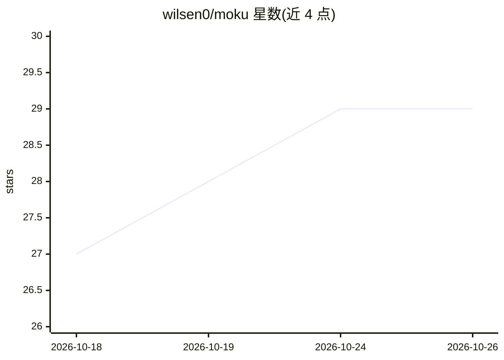

# wilsen0/moku

⭐ 29 · HTML · 推送 2026-10-23 · [GitHub](https://github.com/wilsen0/moku) · [官网](https://mokuapp.dev/) · 组织维护 · 中文 README

**移动/桌面跨平台 SSH 工作台：扫描并一键恢复远端 AI 编程会话**

面向使用 AI 编程 CLI 的开发者，提供 iOS/Android（macOS/Windows/Linux 准备中）应用：通过既有 SSH 连接扫描远端主机上 Claude Code、Codex、OpenCode 等 12+ 种编程代理留下的会话日志与 SQLite 存储，转为可搜索的项目列表，一键在交互式终端中恢复会话。内置 Rust 终端引擎、Mosh 漫游与 abduco 后台保活，附带 SFTP、主机遥测与 Docker 管理。凭据本地加密存储，AI 助手直连用户配置的 API。注意：源码尚未开源，计划达 1 万 star 后开放。

## 筛选速览

| 维度 | 判定 | 备注 |
|---|---|---|
| AI 角色 | `ai-enhanced` | 去掉 AI 部分产品仍成立 |
| 许可风险 | `none` | — |
| 部署形态 | `None` |  |
| 模型依赖 | — | README 未给出锁定关系 |
| 硬件要求 | — | 无带数字的原话,不猜 |
| 安装摩擦 | `low` | 无编译、无系统依赖或容器化 |
| 成熟度 | `idea` | |

## 能力要点

- 自动扫描远端主机上 12+ 种 AI 编程 CLI 的会话日志与 SQLite 存储
- 一键在交互式终端恢复会话，远端零安装（纯 SSH）
- Rust 终端引擎（ANSI 流 28 MB/s）+ Mosh 漫游 + abduco 断线保活
- 本地优先：凭据设备端加密，AI 请求直连用户配置的 API 端点

## 适用场景

- 在手机上随时找回并继续远端服务器上的 Claude Code / Codex 等会话
- 移动网络切换时保持终端会话不中断
- 在移动端进行 SFTP 文件编辑、查看主机资源与 Docker 容器

## 场景标签

 · 领域:开发者工具/远程终端

## 证据(README 行号)

> L5:  Your remote agents, in your pocket.
> L6:  The focused cross-platform SSH workspace that scans & resumes your AI coding sessions.
> L24: Underneath the glass is a **high-throughput Rust terminal core** and **Mosh/abduco zero-drop persistence**, enginee

## 星数曲线

2026-10-18 27 → 2026-10-26 29（+2）

---
*卡片 v1 · prompt 1.4 · 生成 2026-10-26 · 置信度 high · 依据 README sha `6c191a1be890` · [字段定义](../../DATASET.md)*
