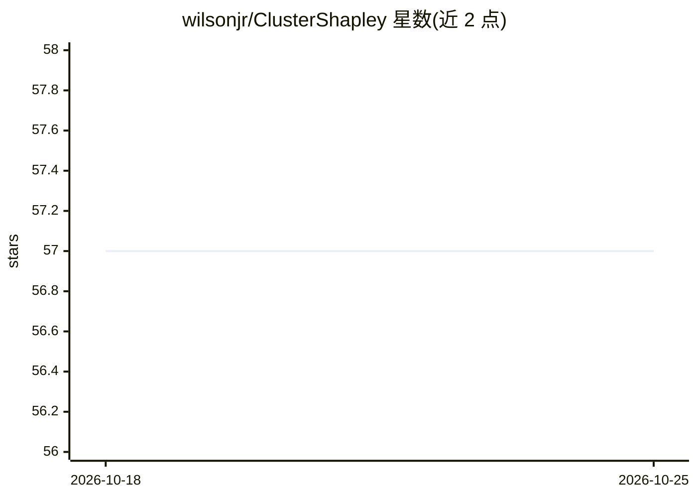

# wilsonjr/ClusterShapley

⭐ 57 · C++ · BSD-3-Clause · 推送 2026-01-05 · [GitHub](https://github.com/wilsonjr/ClusterShapley) · 个人维护

**解释降维聚类形成原因的 Python 库（基于 Shapley 值）**

ClusterShapley 是解释非线性降维（DR）结果的可解释机器学习库：对投影到 2D 后形成的聚类，计算各特征对类内凝聚度的 Shapley 贡献值，输出可配合 SHAP 可视化（beeswarm 图）的贡献矩阵。遵循 sklearn 风格的 fit/transform 接口，可作用于数据集自身标签，也可对 KMeans 等自定义聚类标签解释。依赖 shap、numpy、scipy、scikit-learn、pybind11，通过 PyPI 以 pip 安装。配套论文发表于 Expert Systems with Applications（2021）。

## 筛选速览

| 维度 | 判定 | 备注 |
|---|---|---|
| AI 角色 | `ai-ecosystem` | LLM/agent 周边工具 |
| 许可风险 | `permissive` | BSD-3-Clause |
| 部署形态 | `library` | 以包/库形式分发 |
| 模型依赖 | — | README 未给出锁定关系 |
| 硬件要求 | — | 无带数字的原话,不猜 |
| 安装摩擦 | `low` | 无编译、无系统依赖或容器化 |
| 成熟度 | — | 结构信号不足 |

## 能力要点

- 计算各特征对聚类凝聚度的 Shapley 贡献值
- sklearn 风格 fit/transform 接口
- 支持自定义聚类标签（如 KMeans 结果）的解释
- 贡献值可复用 SHAP 的 beeswarm 等可视化

## 适用场景

- 我想知道 UMAP 投影后某类聚在一起是哪些特征驱动的
- 对降维结果的聚类做特征归因分析并出图
- 解释两个类被聚到一起、第三个类远离的原因

## 场景标签

 · 领域:机器学习/可解释性

## 证据(README 行号)

> L13: ClusterShapley is a technique to explain non-linear dimendionality reduction results. You can explain the cluster f
> L61: Now, you can generate explanations to understand why UMAP (or any other DR technique) imposed that cluster formatio

## 星数曲线

2026-10-18 57 → 2026-10-25 57（+0）

---
*卡片 v1 · prompt 1.4 · 生成 2026-10-24 · 置信度 high · 依据 README sha `dab8feab78ba` · [字段定义](../../DATASET.md)*
