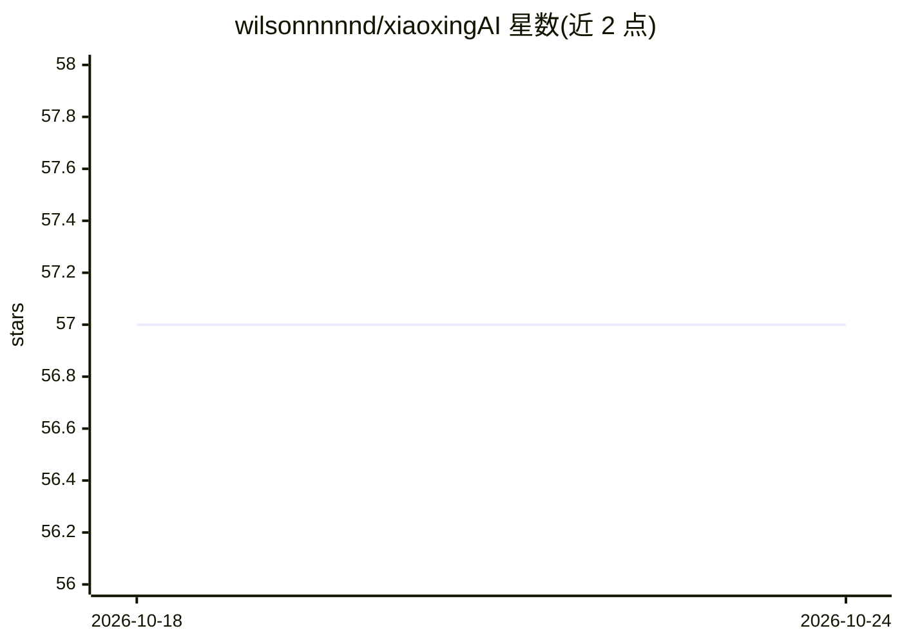

# wilsonnnnnd/xiaoxingAI

⭐ 57 · TypeScript · MIT · 推送 2026-05-20 · [GitHub](https://github.com/wilsonnnnnd/xiaoxingAI) · 个人维护 · 中文 README

**面向 Gmail 工作流的开发者：AI SaaS 全栈应用（含用量计量）**

生产风格的全栈 AI SaaS 应用：FastAPI 后端 + React 前端，围绕 Gmail 驱动的工作流构建。提供公开营销首页、认证用户仪表盘与管理员仪表盘三个产品面；核心机制包括每用户 OAuth 的 Gmail 处理管道与 worker 轮询、Telegram 机器人通知、按请求记录模型/token/估算成本并写入 ai_usage_analytics 的 AI 用量追踪，以及可通过 AI_PRICING_JSON 与管理界面配置的定价体系。LLM 凭据按部署模式可选。运行需 Python 3.11+、Node.js 18+、PostgreSQL，推荐 Redis。以源码方式本地运行，文档树 docs/ 为维护源头。

## 筛选速览

| 维度 | 判定 | 备注 |
|---|---|---|
| AI 角色 | `ai-enhanced` | 去掉 AI 部分产品仍成立 |
| 许可风险 | `permissive` | MIT |
| 部署形态 | `library` | 以包/库形式分发 |
| 模型依赖 | — | README 未给出锁定关系 |
| 硬件要求 | — | 无带数字的原话,不猜 |
| 安装摩擦 | `low` | 无编译、无系统依赖或容器化 |
| 成熟度 | — | 结构信号不足 |

## 能力要点

- 按请求记录模型、token 与估算成本的 AI 用量追踪（写入 ai_usage_analytics）
- 每用户 OAuth 的 Gmail worker 轮询管道与自动化规则
- 通过 AI_PRICING_JSON、API 与管理界面配置的定价表
- 三产品面（公开首页/用户仪表盘/管理员仪表盘）与角色感知访问控制

## 适用场景

- 部署一套带计量的 Gmail AI 处理 SaaS 平台
- 按用户/模型维度查看 AI 用量与成本报表
- 在邮件工作流中接入 AI 处理并通过 Telegram 通知

## 场景标签

`工作流自动化` · 领域:效率与自动化

## 证据(README 行号)

> L3: Xiaoxing AI is a production-style AI SaaS application for Gmail-driven workflows.
> L28: - AI usage tracking with per-request model, token, and estimated-cost analytics
> L116: → AI provider call

## 星数曲线

2026-10-18 57 → 2026-10-24 57（+0）

---
*卡片 v1 · prompt 1.4 · 生成 2026-10-24 · 置信度 mid · 依据 README sha `134591ae77b4` · [字段定义](../../DATASET.md)*
