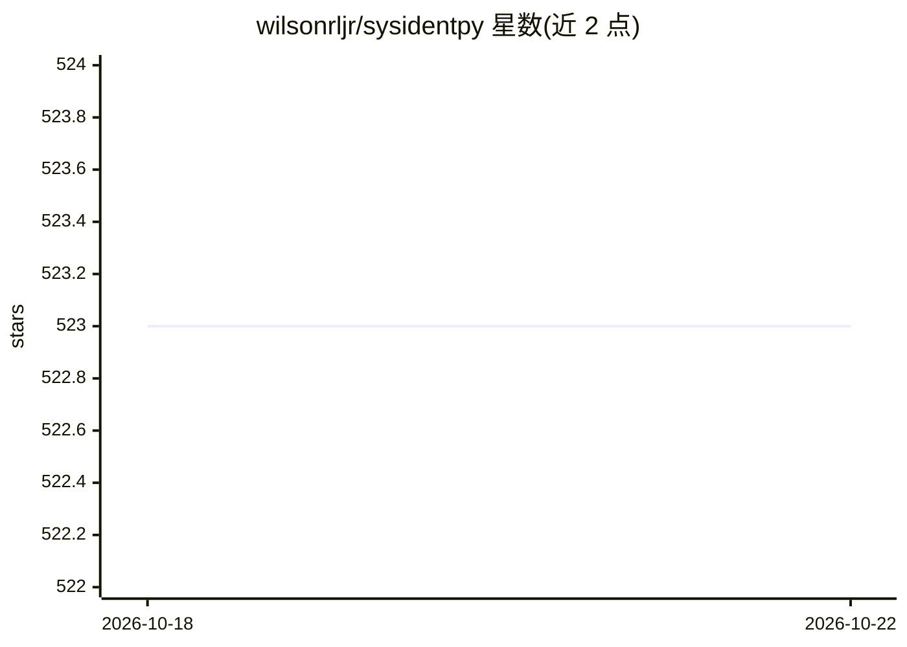

# wilsonrljr/sysidentpy

⭐ 523 · Python · BSD-3-Clause · 推送 2026-09-13 · [GitHub](https://github.com/wilsonrljr/sysidentpy) · [官网](https://sysidentpy.org) · 个人维护

**基于 NARMAX 的系统辨识与时间序列预测 Python 库**

基于 NumPy 构建的开源 Python 模块（BSD-3），用于非线性动态系统辨识和时间序列预测，支持 NARX/NARMA/ARMAX/ARX 等多种模型变体。提供 FROLS、MetaMSS、AOLS 等模型结构选择算法、15 种以上参数估计方法、8 种基函数，并可通过 PyTorch 构建 Neural NARX 模型，或接入 scikit-learn、CatBoost 等估计器。附带配套书籍、20 余个示例与 JOSS 论文，定位为 Matlab System Identification Toolbox 的免费开源替代。需要 Python≥3.10 及 NumPy/Matplotlib/PyTorch/scipy。

## 筛选速览

| 维度 | 判定 | 备注 |
|---|---|---|
| AI 角色 | `ai-native` | 本体是模型或模型工具 |
| 许可风险 | `permissive` | BSD-3-Clause |
| 部署形态 | `library` | 以包/库形式分发 |
| 模型依赖 | — | README 未给出锁定关系 |
| 硬件要求 | — | 无带数字的原话,不猜 |
| 安装摩擦 | `low` | 无编译、无系统依赖或容器化 |
| 成熟度 | — | 结构信号不足 |

## 能力要点

- NARMAX 及其变体（NARX/NARMA/ARMAX/ARX 等）建模
- FROLS、MetaMSS、AOLS、Entropic Regression 等多种结构选择算法
- PyTorch Neural NARX 模型与 scikit-learn/CatBoost 通用估计器接入
- 实验性 Array API 支持（NumPy/PyTorch 后端为主，CuPy/JAX 为实验目标）

## 适用场景

- 为动态系统构建非线性预测模型并估计参数
- 时间序列预测与基准对比
- 复现论文中的 NARMAX 模型结果
- 用神经网络或 CatBoost 等估计器构建 NARX 模型

## 场景标签

 · 领域:科学计算/时间序列与动态系统建模

## 证据(README 行号)

> L24: SysIdentPy is an open-source Python module for System Identification using **NARMAX** models built on top of **nump
> L28: - Build and customize nonlinear forecasting models.
> L30: - Experiment with neural NARX models and other advanced algorithms.

## 星数曲线

2026-10-18 523 → 2026-10-22 523（+0）

---
*卡片 v1 · prompt 1.4 · 生成 2026-10-21 · 置信度 high · 依据 README sha `9f3b9dba2456` · [字段定义](../../DATASET.md)*
