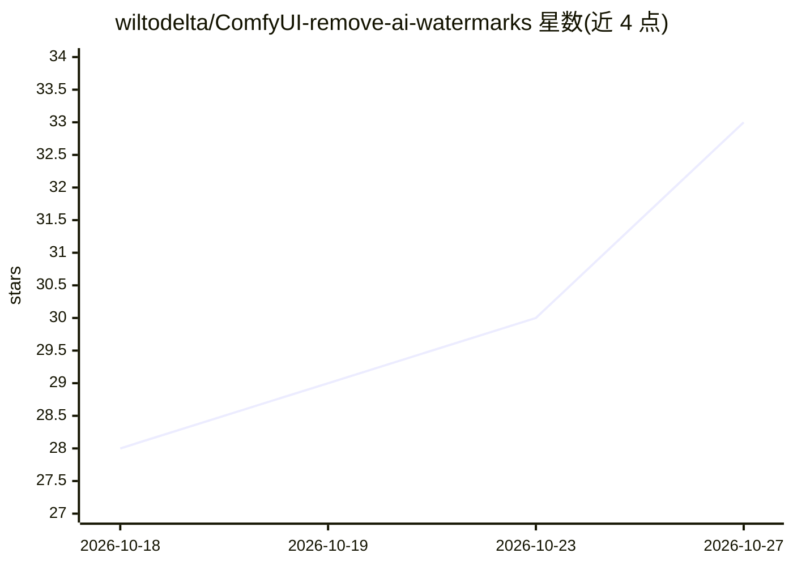

# wiltodelta/ComfyUI-remove-ai-watermarks

⭐ 33 · Python · Apache-2.0 · 推送 2026-10-23 · [GitHub](https://github.com/wiltodelta/ComfyUI-remove-ai-watermarks) · 个人维护

**ComfyUI 自定义节点集：检测并移除图像中的可见/不可见 AI 水印**

面向 ComfyUI 用户的自定义节点集，基于 remove-ai-watermarks 库提供 7 个节点：可见水印检测与移除（RAIW 注册标记、自动模式带灵敏度检测）、不可见水印/SynthID 移除（经 CUDA-only 的 qwen-zimage/sdxl-zimage/chroma-zimage 扩散再生）、C2PA 等溯源信息读取、AI 元数据无损剥离、区域擦除（cv2/LaMa/MI-GAN 填充）及一键全流程。像素节点在内存中处理图像批次，溯源类节点需传入文件路径。可通过 ComfyUI Manager 或手动 git clone + pip 安装，模型权重首次使用时下载。

## 筛选速览

| 维度 | 判定 | 备注 |
|---|---|---|
| AI 角色 | `ai-enhanced` | 去掉 AI 部分产品仍成立 |
| 许可风险 | `permissive` | Apache-2.0 |
| 部署形态 | `library` | 以包/库形式分发 |
| 模型依赖 | — | README 未给出锁定关系 |
| 硬件要求 | — | 无带数字的原话,不猜 |
| 安装摩擦 | `medium` | 含编译或系统依赖之一 |
| 成熟度 | — | 结构信号不足 |

## 能力要点

- 7 个节点覆盖可见/不可见水印移除、溯源识别、元数据剥离与区域擦除
- 不可见水印移除通过 CUDA-only 扩散再生（qwen-zimage/sdxl-zimage/chroma-zimage/auto 四种 profile）
- 可见水印检测与默认 cv2 填充无需 GPU
- 支持 ComfyUI Manager 安装，模型权重首次使用时下载

## 适用场景

- 在 ComfyUI 工作流中移除图像上的可见 AI 溯源标记
- 清除 SynthID 等不可见水印与 AI 元数据
- 读取并验证图像的 C2PA 溯源报告
- 擦除图像中指定遮罩区域并重新填充

## 场景标签

 · 领域:图像处理/生成式 AI 工具链

## 证据(README 行号)

> L3: ComfyUI custom nodes for
> L13: |**Remove Visible Watermark (RAIW)**|Removes every detected registered AI-provenance mark when `mark = auto`, or fo

## 星数曲线

2026-10-18 28 → 2026-10-27 33（+5）

---
*卡片 v1 · prompt 1.4 · 生成 2026-10-26 · 置信度 high · 依据 README sha `7cff9b615231` · [字段定义](../../DATASET.md)*
