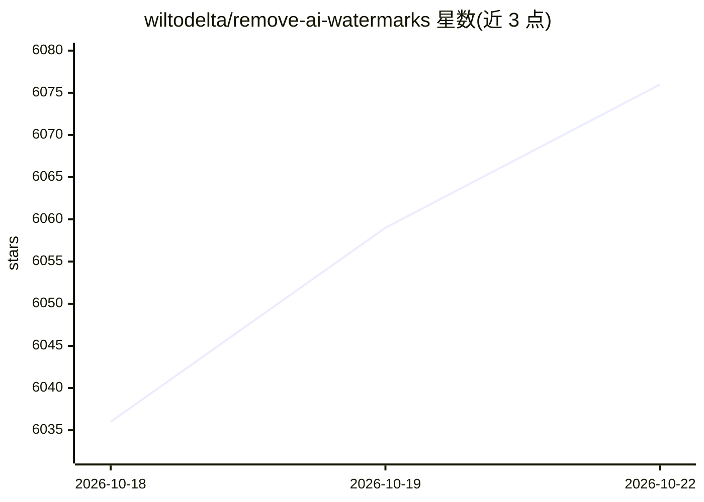

# wiltodelta/remove-ai-watermarks

⭐ 6,092 · Python · Apache-2.0 · 推送 2026-10-22 · [GitHub](https://github.com/wiltodelta/remove-ai-watermarks) · [官网](https://raiw.cc) · 个人维护

**去除自有 AI 生成内容的水印与溯源元数据的 Python 库/CLI**

面向拥有内容本人的研究项目，提供识别与移除图像/视频中的可见 AI 水印（Gemini、Sora、Veo、Seedance、Dola、Hailuo、Kling 等）、不可见像素水印（扩散重生成或本地像素扰动）以及 C2PA/EXIF/XMP/IPTC 等 AI 元数据。以 Python 库、CLI、agent skill（npx skills add）三种形式提供，按 extras 分模块安装；不可见移除的扩散路径仅支持 CUDA，无 CPU/MPS 回退。README 明确声明部分司法辖区（含中国）限制移除 AI 标识，另有付费托管服务 raiw.cc。

## 筛选速览

| 维度 | 判定 | 备注 |
|---|---|---|
| AI 角色 | `ai-native` | 本体是模型或模型工具 |
| 许可风险 | `permissive` | Apache-2.0 |
| 部署形态 | `library` | 以包/库形式分发 |
| 模型依赖 | — | README 未给出锁定关系 |
| 硬件要求 | — | 无带数字的原话,不猜 |
| 安装摩擦 | `medium` | 含编译或系统依赖之一 |
| 成熟度 | — | 结构信号不足 |

## 能力要点

- identify/visible/metadata/video 等命令覆盖图像与六种容器格式的视频元数据检查与移除
- 不可见水印经扩散重生成（CUDA-only）或本地像素扰动路径处理
- 以 agent skill 形式供 Claude Code、Codex、Cursor 等 agent 调用
- 照片 AI/相机像素分类与 OpenAI/Google/unknown 来源分类可选安装

## 适用场景

- 移除自己生成的图像/视频上的可见 AI 标识与水印
- 清理导出文件中的 C2PA/EXIF/XMP 等 AI 溯源元数据
- 检查文件携带哪些 AI 溯源信号

## 场景标签

`图像视频处理` · 领域:感知与多模态

## 证据(README 行号)

> L3: Remove AI provenance marks from images and video you generated yourself:
> L48: |Find provenance signals and watermarks|`identify`|No|
> L49: |Classify a photograph from pixels (opt-in, not provenance)|`classify`|No|

## 星数曲线

2026-10-18 6,036 → 2026-10-22 6,076（+40）

---
*卡片 v1 · prompt 1.4 · 生成 2026-10-20 · 置信度 high · 依据 README sha `b6de0c3a976b` · [字段定义](../../DATASET.md)*
