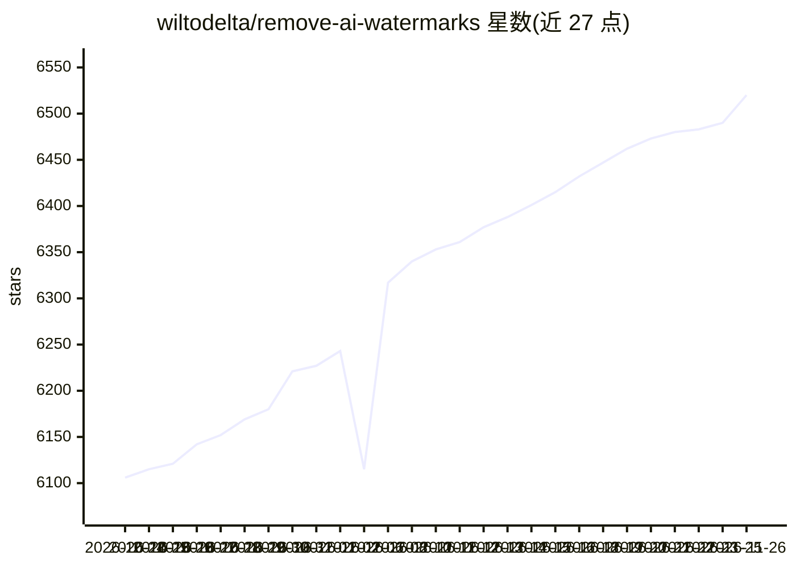

# wiltodelta/remove-ai-watermarks

⭐ 6,520 · Python · Apache-2.0 · 推送 2026-11-25 · [GitHub](https://github.com/wiltodelta/remove-ai-watermarks) · [官网](https://raiw.cc) · 个人维护

**为自有 AI 生成内容清除可见/隐形水印与来源元数据的工具**

面向自有生成内容的 AI 溯源标记处理工具，以 Python 库、CLI 和 agent skill 三种形态分发。功能覆盖识别溯源信号、移除已注册的可见水印（图像支持 Gemini sparkle 等，视频覆盖 23 种标记）、剥离 C2PA/EXIF/XMP/IPTC 元数据、处理兼容的公开音频水印；隐形水印移除依赖扩散重建，需 CUDA。文本水印支持本地 Transformers 重写器及可选 Ollama 后端。声明仅限自有内容合法使用，不针对第三方付费内容水印。

## 筛选速览

| 维度 | 判定 | 备注 |
|---|---|---|
| AI 角色 | `ai-native` | 本体是模型或模型工具 |
| 许可风险 | `permissive` | Apache-2.0 |
| 部署形态 | `library` | 以包/库形式分发 |
| 模型依赖 | local-ok | 支持本地模型 |
| 硬件要求 | — | 无带数字的原话,不猜 |
| 安装摩擦 | `medium` | 含编译或系统依赖之一 |
| 成熟度 | — | 结构信号不足 |

## 能力要点

- 图像/视频/音频/文本四类媒体的 AI 水印与元数据处理
- 视频识别 23 种可见 AI 标记并支持选择性 GOP 流拷贝
- 元数据剥离（C2PA/EXIF/XMP/IPTC 及 TC260 AIGC 标签）无需 GPU
- 同时提供 Python 库、CLI 与 agent skill 安装方式

## 适用场景

- 清理自己生成的图片上的 Gemini 可见水印
- 批量去除视频中的 AI 元数据和厂商标记
- 检测图像中残留的 AI 溯源信号

## 场景标签

`图像视频处理` · 领域:感知与多模态

## 证据(README 行号)

> L3: Remove AI provenance marks from images, video, and audio you generated yourself:
> L16: npx skills add wiltodelta/remove-ai-watermarks    # agent skill for Claude Code, Codex, Cursor, and other agents
> L40: > This is a research project on AI provenance signals, for lawful use on content

## 星数曲线

2026-10-24 6,106 → 2026-11-26 6,520（+414）

---
*卡片 v1 · prompt 1.4 · 生成 2026-11-24 · 置信度 high · 依据 README sha `70ab9ceeaa75` · [字段定义](../../DATASET.md)*
