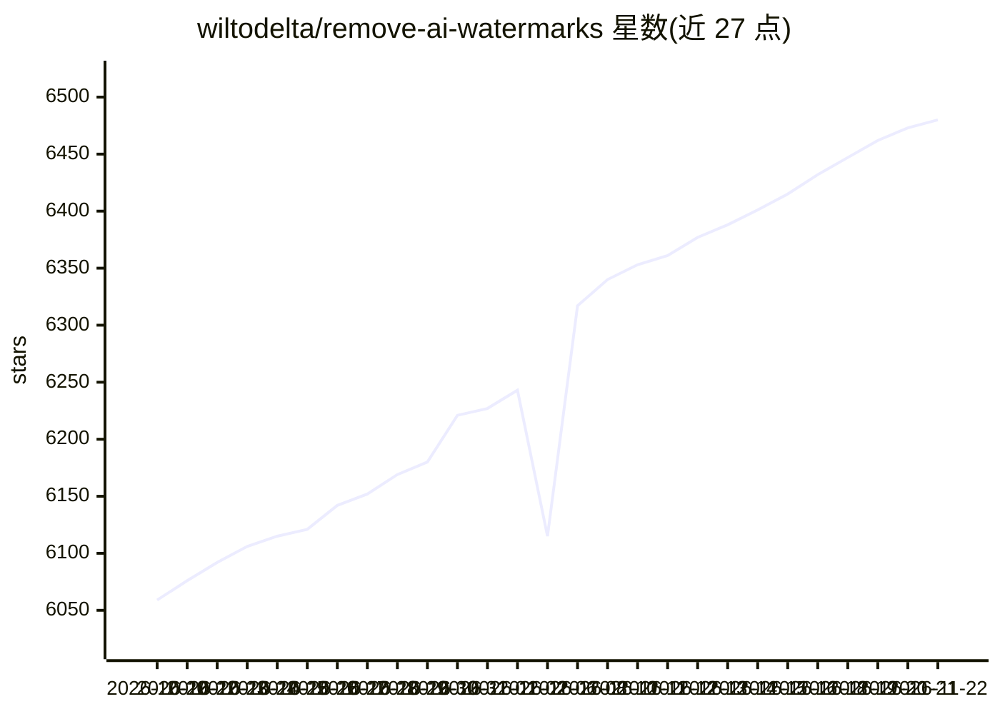

# wiltodelta/remove-ai-watermarks

⭐ 6,480 · Python · Apache-2.0 · 推送 2026-11-21 · [GitHub](https://github.com/wiltodelta/remove-ai-watermarks) · [官网](https://raiw.cc) · 个人维护

**去除自生成图像/视频/音频中 AI 水印与溯源元数据的 Python 库与 CLI**

面向用户自己生成的内容，提供 CLI、Python 库与 agent skill 三种形态，覆盖：已知可见水印（Gemini 星标、Sora/Veo/Seedance/豆包/海螺/Kling 等视频标记）的检测与移除、C2PA/EXIF/XMP/IPTC 元数据清除、兼容公开音频水印（AudioSeal 等）的处理，以及基于扩散重生成或 VAE 的不可见水印去除（需 CUDA）。按功能拆分为多个 extras 安装档位；包内不含本地 SynthID 像素检测器。声明为研究项目，限自有内容合法使用。

## 筛选速览

| 维度 | 判定 | 备注 |
|---|---|---|
| AI 角色 | `ai-enhanced` | 去掉 AI 部分产品仍成立 |
| 许可风险 | `permissive` | Apache-2.0 |
| 部署形态 | `library` | 以包/库形式分发 |
| 模型依赖 | local-ok | 支持本地模型 |
| 硬件要求 | — | 无带数字的原话,不猜 |
| 安装摩擦 | `medium` | 含编译或系统依赖之一 |
| 成熟度 | `idea` | |

## 能力要点

- 支持图像/视频/音频的可见水印、不可见水印、溯源元数据三类处理
- 按 extras 拆分安装档位（metadata/visible/video/audio/detect 等 10+ 组合）
- 提供 agent skill，可接入 Claude Code、Codex、Cursor 等 agent
- 视频不可见水印去除提供 oracle 认证的 VAE 重生成路径（CUDA）

## 适用场景

- 清理自己生成的 AI 图像/视频中的可见水印与元数据
- 检测图片或视频中的溯源信号与水印痕迹
- 批量处理目录下的视频文件做溯源清理

## 场景标签

`图像视频处理` · 领域:感知与多模态

## 证据(README 行号)

> L3: Remove AI provenance marks from images, video, and audio you generated yourself:
> L38: > This is a research project on AI provenance signals, for lawful use on content
> L71: |Regenerate an image to disrupt invisible watermarks|`invisible`|Required (CUDA)|

## 星数曲线

2026-10-20 6,059 → 2026-11-22 6,480（+421）

---
*卡片 v1 · prompt 1.4 · 生成 2026-11-22 · 置信度 high · 依据 README sha `768c60763ffc` · [字段定义](../../DATASET.md)*
