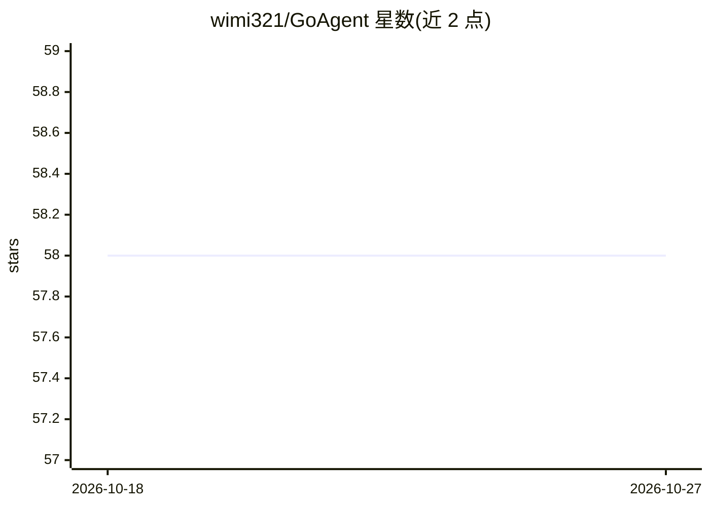

# wimi321/GoAgent

⭐ 58 · TypeScript · MIT · 推送 2026-10-22 · [GitHub](https://github.com/wimi321/GoAgent) · [官网](https://github.com/wimi321/GoAgent/releases/latest) · 个人维护 · 中文 README

**本地优先的桌面围棋学习工作台，KataGo+多模态LLM当AI老师**

跨平台 Electron 桌面围棋智能体：KataGo 负责局面事实判断（胜率、目差、推荐点），用户配置的多模态 LLM 将棋盘截图、分析 JSON、本地知识卡与学生画像组合成自然语言复盘讲解。AI 老师可调用 9 种工具（筛选棋谱、读取 SGF、分析局面、生成截图、检索知识库、读写学生画像、保存报告等），支持野狐棋谱同步与 SGF 导入。提供 macOS/Windows 安装包，AI 讲解需自备 OpenAI-compatible API Key 或 ChatGPT 登录；本机算力不足时可配置 iKataGo/智子云远程引擎。项目自述处于公开发布早期，Windows ARM64 暂不支持。

## 筛选速览

| 维度 | 判定 | 备注 |
|---|---|---|
| AI 角色 | `ai-native` | 本体是模型或模型工具 |
| 许可风险 | `permissive` | MIT |
| 部署形态 | `desktop` | 安装包/桌面程序 |
| 模型依赖 | — | README 未给出锁定关系 |
| 硬件要求 | — | 无带数字的原话,不猜 |
| 安装摩擦 | `low` | 无编译、无系统依赖或容器化 |
| 成熟度 | `idea` | |

## 能力要点

- KataGo 事实判断 + 多模态 LLM 讲棋的智能体架构
- AI 老师可调用 9 种工具（棋谱筛选/局面分析/知识检索/学生画像读写/报告保存等）
- 内置定式、棋形、手筋知识库并本地识别棋形
- macOS 包已 Developer ID 签名并通过 Apple 公证

## 适用场景

- 复盘棋局，找出问题手与胜负转折点并得到讲解
- 分析某棋手最近多局棋，定位常见弱点
- 根据弱点生成训练计划并保存报告
- 加载 SGF/野狐棋谱进行 KataGo 实时分析

## 场景标签

 · 领域:游戏/围棋教育

## 证据(README 行号)

> L25: GoAgent · 围棋智能体是一个本地优先、跨平台的桌面围棋学习工作台。它不是把聊天框放在棋盘旁边，而是把 KataGo、棋盘截图、本地知识库、学生长期画像和多模态 LLM 组织成一个会执行任务的围棋智能体。
> L34: KataGo 是事实裁判，LLM 是讲棋老师。GoAgent 的目标是让学生不仅知道哪一步不好，还能理解为什么不好，以及下一周该怎么练。
> L91: 当前手分析会把这些信息组合给用户配置的多模态 LLM：

## 星数曲线

2026-10-18 58 → 2026-10-27 58（+0）

---
*卡片 v1 · prompt 1.4 · 生成 2026-10-24 · 置信度 mid · 依据 README sha `a8d8da35db0f` · [字段定义](../../DATASET.md)*
