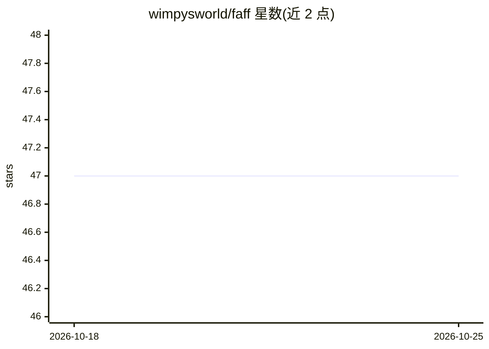

# wimpysworld/faff

⭐ 47 · Shell · MIT · 推送 2026-01-22 · [GitHub](https://github.com/wimpysworld/faff) · [官网](https://wimpysworld.com/posts/faff-ollama-conventional-commit-generator/) · 个人维护

**本地 LLM 生成 Conventional Commits 提交信息的 Bash CLI**

faff 是一个 Bash 脚本工具：读取 git 暂存区的 diff，调用本地运行的 Ollama LLM（默认 qwen2.5-coder:7b，可用 FAFF_MODEL 环境变量更换为任意 Ollama 支持的模型），生成符合 Conventional Commits 1.0.0 规范的提交信息。代码不出本机。自动检测项目中的 .commitlintrc.json / commitlint.config.json，将 rules.scope-enum 中的 scope 约束传给 LLM。依赖 Bash 4+、coreutils、bc、curl、jq，需已安装并运行 Ollama。作者自述这是一个学习项目，README 中部分卖点（如自动下载模型）以自嘲口吻标注为不实。

## 筛选速览

| 维度 | 判定 | 备注 |
|---|---|---|
| AI 角色 | `ai-native` | 本体是模型或模型工具 |
| 许可风险 | `permissive` | MIT |
| 部署形态 | `None` |  |
| 模型依赖 | local-ok | 支持本地模型 |
| 硬件要求 | — | 无带数字的原话,不猜 |
| 安装摩擦 | `low` | 无编译、无系统依赖或容器化 |
| 成熟度 | `idea` | |

## 能力要点

- 从 git 暂存 diff 生 Conventional Commits 1.0.0 提交信息
- 通过本地 Ollama 运行 LLM，代码不出本机
- 自动检测 commitlint 配置并约束生成 scope
- FAFF_MODEL 环境变量切换任意 Ollama 模型

## 适用场景

- 提交前让本地模型代写规范的 commit message
- 有 commitlint scope 约束的团队项目保持提交格式一致
- 不愿把代码 diff 发给云端服务的本地化工作流

## 场景标签

 · 领域:开发者工具/git 自动化

## 证据(README 行号)

> L5: Stop staring at that staged diff like it owes you money. We all know the drill: you've made brilliant changes, `git`
> L19: - **🤖 AI-Powered**: Uses local Ollama LLMs for *"intelligent"* commit message generation

## 星数曲线

2026-10-18 47 → 2026-10-25 47（+0）

---
*卡片 v1 · prompt 1.4 · 生成 2026-10-25 · 置信度 high · 依据 README sha `eb836d6b4e76` · [字段定义](../../DATASET.md)*
