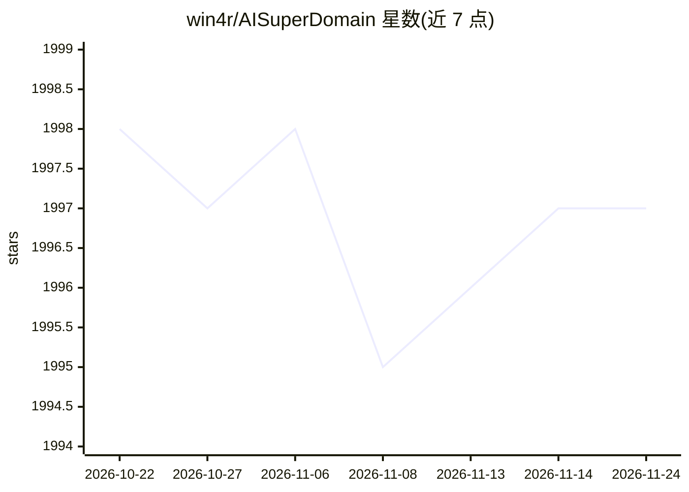

# win4r/AISuperDomain

⭐ 1,998 · C# · Apache-2.0 · 推送 2026-11-07 · [GitHub](https://github.com/win4r/AISuperDomain) · [官网](https://space.bilibili.com/3493277319825652) · 个人维护 · 中文 README

**一次提问同时获取多个 AI 回答的桌面聚合客户端**

跨 Windows、macOS、Android 的桌面应用，将多个 AI 聊天服务整合到一个界面：用户提问后可同时收到多个 AI 的回答。支持可配置的模型列表，通过 JSON 配置文件添加新 AI、修改提示词；可设置同时显示 1/2/3/4/6 个 AI 的回答，提供全屏查看、'/'提示建议、'#'持久提示等交互方式。安装方式为下载 Releases 安装包，Windows 需预装 .NET 8 并安装提供的证书。

## 筛选速览

| 维度 | 判定 | 备注 |
|---|---|---|
| AI 角色 | `ai-native` | 本体是模型或模型工具 |
| 许可风险 | `permissive` | Apache-2.0 |
| 部署形态 | `None` |  |
| 模型依赖 | — | README 未给出锁定关系 |
| 硬件要求 | — | 无带数字的原话,不猜 |
| 安装摩擦 | `medium` | 含编译或系统依赖之一 |
| 成熟度 | — | 结构信号不足 |

## 能力要点

- 一次提问同时获取 10+ 个 AI 的回答
- 通过 JSON 配置文件自定义 AI 列表与提示词，可按网页输入框 HTML 编写脚本接入新 AI
- 可配置同时显示的回答数量与全屏查看
- 提供 '/' 提示建议与 '#' 持久提示交互

## 适用场景

- 把同一个问题同时发给多个 AI 并排比较回答
- 在一个客户端里集中使用多个 AI 聊天服务
- 通过配置文件添加自定义的 AI 网页入口

## 场景标签

`聊天机器人` `AI 助手` · 领域:对话与助手

## 证据(README 行号)

> L13: Welcome to the Aila Desktop Application GitHub repository! This innovative software integrates multiple leading AI 
> L21: Aila currently supports the following AI models:
> L79: Windows users must ensure that their system has .NET 8 installed prior to installation. Additionally, you will need

## 星数曲线

2026-10-22 1,998 → 2026-11-24 1,997（-1）

---
*卡片 v1 · prompt 1.4 · 生成 2026-11-24 · 置信度 high · 依据 README sha `c1546c096ceb` · [字段定义](../../DATASET.md)*
