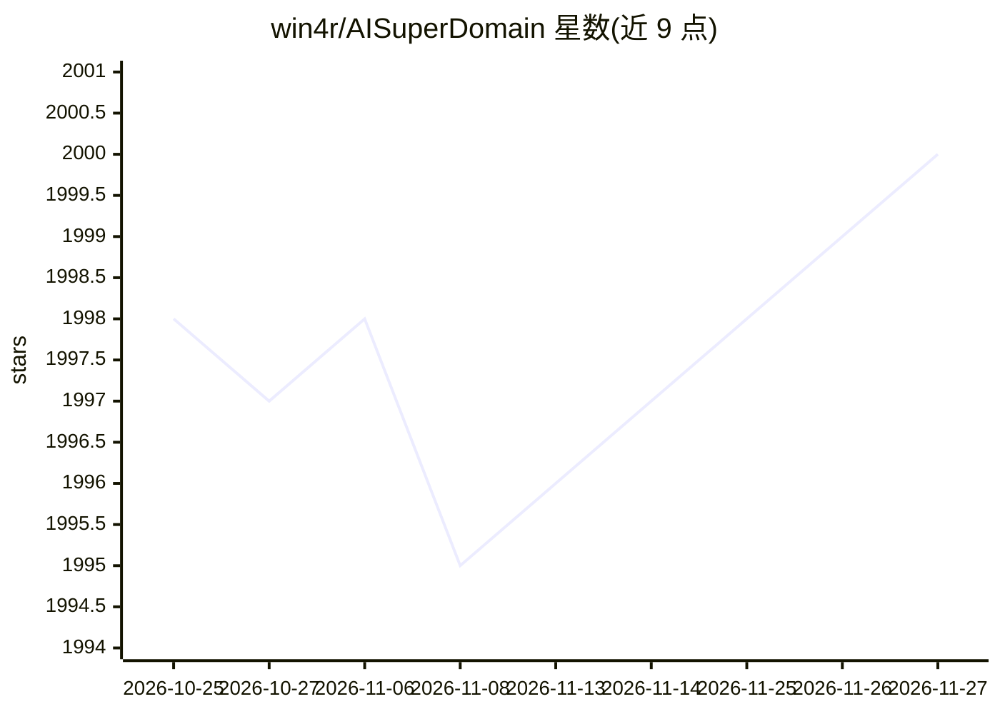

# win4r/AISuperDomain

⭐ 2,000 · C# · Apache-2.0 · 推送 2026-11-26 · [GitHub](https://github.com/win4r/AISuperDomain) · [官网](https://www.bilibili.com/video/BV1gM411L7K3/) · 个人维护 · 中文 README

**桌面多 AI 聚合客户端：一次提问同时获取多个 AI 回答**

Aila 是一款桌面应用，将多个 AI 聊天服务整合到一个界面：用户输入一个问题，可同时收到多个 AI 的回答，并可选择同时显示 1/2/3/4/6 个 AI 的回复窗口。支持全屏查看单个回答、提示词建议与持久提示、JSON 配置文件自定义模型与提示词，还可通过浏览器 devtool 检查网页输入框并编写脚本接入任意新 AI。通过 Releases 下载安装包安装，Windows 需预装 .NET 8 并安装证书。

## 筛选速览

| 维度 | 判定 | 备注 |
|---|---|---|
| AI 角色 | `ai-native` | 本体是模型或模型工具 |
| 许可风险 | `permissive` | Apache-2.0 |
| 部署形态 | `None` |  |
| 模型依赖 | — | README 未给出锁定关系 |
| 硬件要求 | — | 无带数字的原话,不猜 |
| 安装摩擦 | `medium` | 含编译或系统依赖之一 |
| 成熟度 | — | 结构信号不足 |

## 能力要点

- 一次提问同时获取多个 AI 模型的回答
- 可配置同时显示 1/2/3/4/6 个 AI 回复窗口
- 通过 JSON 配置文件添加新 AI 模型与修改提示词
- 提供用 ChatGPT 辅助生成接入脚本的流程

## 适用场景

- 同时对比多个 AI 对同一问题的回答
- 将常用 AI 服务集中到一个桌面界面使用
- 通过脚本接入列表之外的 AI 网站

## 场景标签

`聊天机器人` `AI 助手` · 领域:对话与助手

## 证据(README 行号)

> L13: Welcome to the Aila Desktop Application GitHub repository! This innovative software integrates multiple leading AI 
> L18: Aila sets itself apart by allowing users to pose a question and receive simultaneous answers from a variety of AI m
> L21: Aila currently supports the following AI models:

## 星数曲线

2026-10-25 1,998 → 2026-11-27 2,000（+2）

---
*卡片 v1 · prompt 1.4 · 生成 2026-11-27 · 置信度 high · 依据 README sha `9cb9450f1e94` · [字段定义](../../DATASET.md)*
