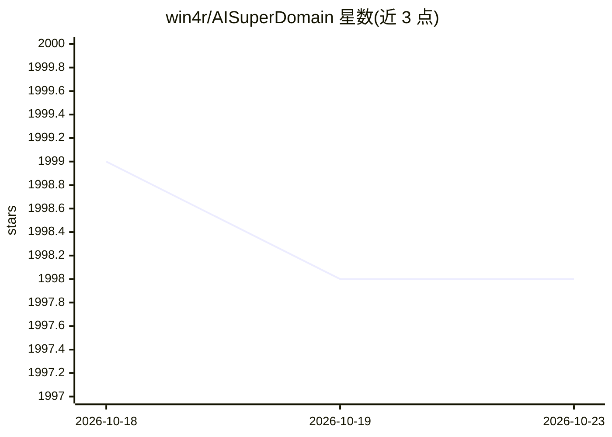

# win4r/AISuperDomain

⭐ 1,998 · C# · Apache-2.0 · 推送 2026-08-09 · [GitHub](https://github.com/win4r/AISuperDomain) · [官网](https://www.youtube.com/@AIsuperdomain) · 个人维护 · 中文 README

**一次提问同时获得 10+ 家 AI 回答的桌面客户端**

面向 Windows/macOS（描述中另含 Android）的桌面应用：用户提交一个问题，可在同一界面并排接收 ChatGPT、Gemini、Claude、Copilot、Perplexity、Kimi、文心一言、通义千问等 20 余家 AI 的回答，支持 1/2/3/4/6 路动态显示与全屏切换。提供斜杠提示词建议、#号持久提示词、JSON 配置文件添加新 AI 或修改提示词；添加新 AI 需通过浏览器 devtool 抓取输入框 HTML 并借助 ChatGPT 生成脚本。Windows 安装前置 .NET 8 与证书。

## 筛选速览

| 维度 | 判定 | 备注 |
|---|---|---|
| AI 角色 | `ai-native` | 本体是模型或模型工具 |
| 许可风险 | `permissive` | Apache-2.0 |
| 部署形态 | `None` |  |
| 模型依赖 | locked-api |  |
| 硬件要求 | — | 无带数字的原话,不猜 |
| 安装摩擦 | `medium` | 含编译或系统依赖之一 |
| 成熟度 | — | 结构信号不足 |

## 能力要点

- 一次提问并行获取 20 余家 AI 的回答
- 1/2/3/4/6 路 AI 响应动态显示与全屏模式
- JSON 配置文件可添加新 AI 模型与自定义提示词
- / 提示词建议与 # 持久提示词交互

## 适用场景

- 同一问题对比多家 AI 的回答差异
- 在一个桌面应用里集中使用已订阅的多个 AI 服务
- 按需接入清单之外的新 AI 站点

## 场景标签

`聊天机器人` · 领域:对话与助手

## 证据(README 行号)

> L13: Welcome to the Aila Desktop Application GitHub repository! This innovative software integrates multiple leading AI 
> L18: Aila sets itself apart by allowing users to pose a question and receive simultaneous answers from a variety of AI m

## 星数曲线

2026-10-18 1,999 → 2026-10-23 1,998（-1）

---
*卡片 v1 · prompt 1.4 · 生成 2026-10-21 · 置信度 high · 依据 README sha `374efb5ffecd` · [字段定义](../../DATASET.md)*
