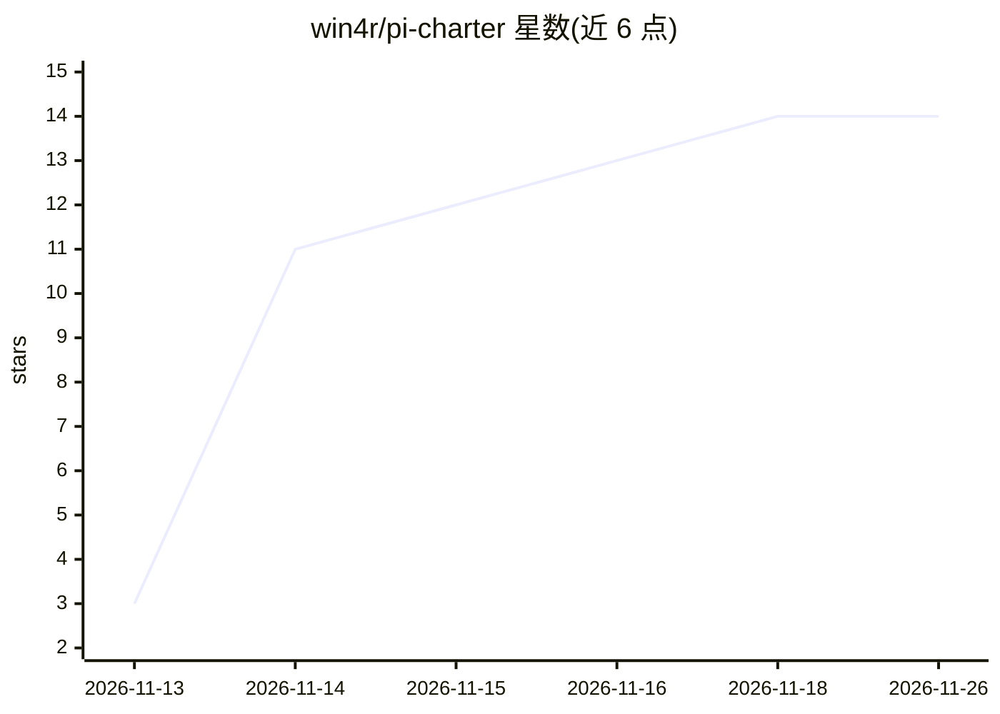

# win4r/pi-charter

⭐ 14 · TypeScript · MIT · 推送 2026-11-16 · [GitHub](https://github.com/win4r/pi-charter) · [官网](https://space.bilibili.com/3493277319825652) · 个人维护 · 中文 README

**为 Pi 编码 agent 提供规格驱动的多 agent 交付流水线**

Pi 编码 agent 的扩展：用户与模型共同起草一份变更契约（charter，含 brief/spec/design），经用户批准后，由代码强制执行的状态机驱动实现者、审计者、优化者等分离 agent 依次完成实现、运行项目检查、独立审计与可选精简，最终从记录的事实生成报告。机制上禁止模型自批规格、跳过审计、批准后改契约或虚报完成；确定性 linter 在批准前检查文档。要求 Pi 1.5+ 与 Node.js 22.19+，git 可选。

## 筛选速览

| 维度 | 判定 | 备注 |
|---|---|---|
| AI 角色 | `ai-ecosystem` | LLM/agent 周边工具 |
| 许可风险 | `permissive` | MIT |
| 部署形态 | `library` | 以包/库形式分发 |
| 模型依赖 | — | README 未给出锁定关系 |
| 硬件要求 | — | 无带数字的原话,不猜 |
| 安装摩擦 | `low` | 无编译、无系统依赖或容器化 |
| 成熟度 | — | 结构信号不足 |

## 能力要点

- 代码强制：模型无法自批规格、跳过审计或改冻结契约
- 实现者/审计者分离，各 agent 在独立会话运行，互不可见彼此报告
- charter_lint 确定性检查需求可追溯性与 GIVEN/WHEN/THEN 完整性
- 单次工具调用驱动整个流水线，支持并行审计分片与 git 检查点回滚

## 适用场景

- 以规格契约方式驱动编码 agent 完成一次代码变更并获得事实化报告
- 要求编码 agent 的工作经过独立审计与测试门禁
- 对已批准的变更做范围受控的精简与回滚

## 场景标签

`多智能体` `编码 Agent` · 领域:Agent 开发

## 证据(README 行号)

> L7: Spec-driven delivery for the Pi coding agent: you and the model write a short contract for one change (a *charter*),
> L9: The workflow is a state machine enforced by code. A model cannot approve its own spec, skip the audit, edit the cont

## 星数曲线

2026-11-13 3 → 2026-11-26 14（+11）

---
*卡片 v1 · prompt 1.4 · 生成 2026-11-18 · 置信度 mid · 依据 README sha `837f380368a4` · [字段定义](../../DATASET.md)*
