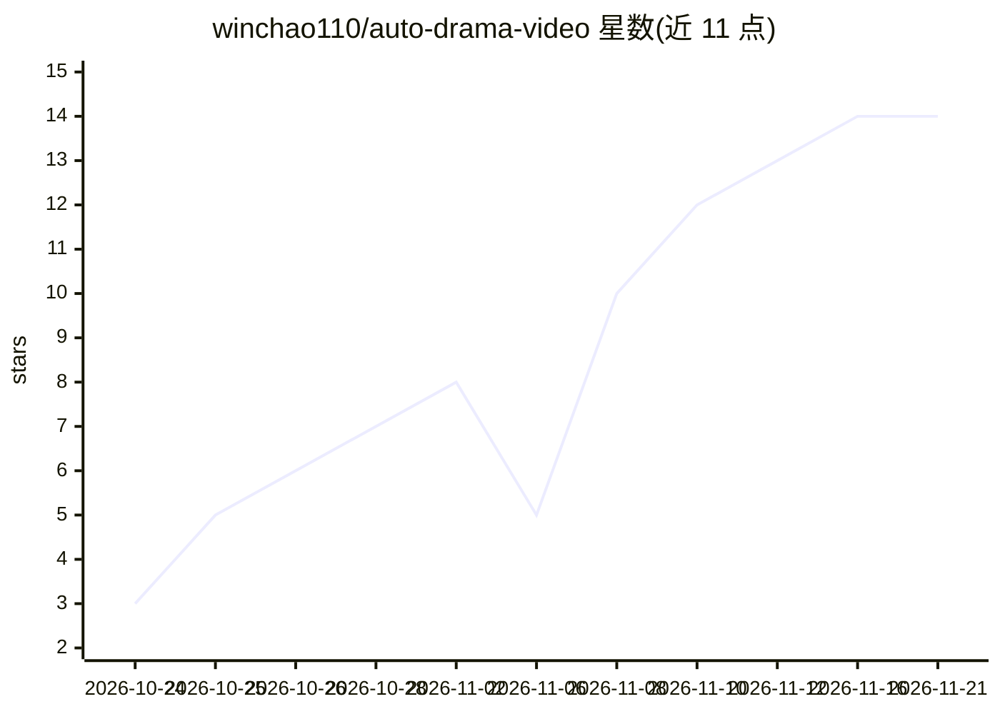

# winchao110/auto-drama-video

⭐ 14 · Python · 推送 2026-10-25 · [GitHub](https://github.com/winchao110/auto-drama-video) · 个人维护 · 中文 README

**面向短剧创作者的全本地小说转视频生成技能包**

以 SKILL.md 技能包形式分发的自动化流水线：输入小说或剧本原文，经 MiniMax H3 分段提示词、Moss Image / Qwen-Image 2.1 资产图、H3 视频三阶段生成带声音的短剧成片。每阶段通过 HTML 工作台人工确认后继续，审核闸门要求产物登记后才能进入下一阶段。只用 Python 标准库直连本地 ComfyUI 的 HTTP 接口，不依赖第三方包；需预先装齐 4 个 ComfyUI 自定义节点及对应模型文件。

## 筛选速览

| 维度 | 判定 | 备注 |
|---|---|---|
| AI 角色 | `ai-native` | 本体是模型或模型工具 |
| 许可风险 | `none` | — |
| 部署形态 | `library` | 以包/库形式分发 |
| 模型依赖 | — | README 未给出锁定关系 |
| 硬件要求 | — | 无带数字的原话,不猜 |
| 安装摩擦 | `low` | 无编译、无系统依赖或容器化 |
| 成熟度 | — | 结构信号不足 |

## 能力要点

- 三阶段流水线（提示词→资产图→视频），每阶段经工作台人工确认
- 只用 Python 标准库直连 ComfyUI HTTP 接口，无第三方依赖
- 音色一致性维护与运镜目录（44 条）自动挂载运镜 LoRA
- 审核闸门：产物未在工作台呈现即拒绝生成

## 适用场景

- 把小说或剧本原文本地生成带配音的分段短剧视频
- 通过对话让智能体代理执行建项目到拼片的流程
- 在无网环境用本机 ComfyUI 跑通图生视频全流程

## 场景标签

`图像生成` `视频生成` `工作流自动化` · 领域:效率与自动化

## 证据(README 行号)

> L19: 把小说、剧本或随口一个点子丢进来，全流程跑在**自己的机器上**：
> L116: - **Python 3.9+**（只用标准库，不需要 `pip install` 任何东西）
> L152: 本技能是一个**纯目录**技能包，不绑定任何平台：一个 `SKILL.md` + `scripts/` + `references/` + `assets/`，

## 星数曲线

2026-10-24 3 → 2026-11-21 14（+11）

---
*卡片 v1 · prompt 1.4 · 生成 2026-11-18 · 置信度 mid · 依据 README sha `06bd4eb1074c` · [字段定义](../../DATASET.md)*
