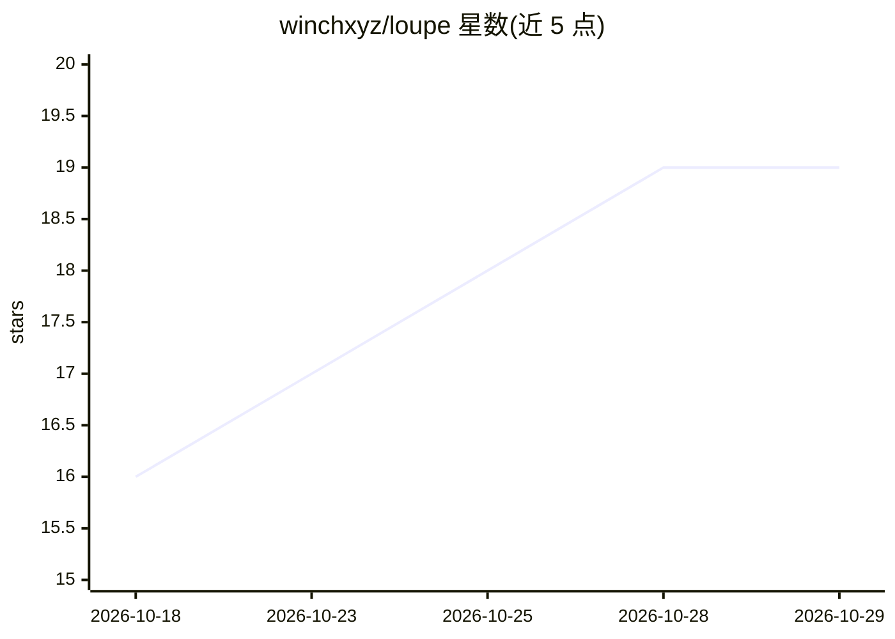

# winchxyz/loupe

⭐ 19 · CSS · MIT · 推送 2026-08-06 · [GitHub](https://github.com/winchxyz/loupe) · [官网](https://tryloupe.app/) · 个人维护

**Windows 本地 AI 网站构建与设计工作室，AI 生成+人工精修**

面向 Windows 的开源桌面应用（Electron）：通过 AI 对话与设计画布构建真实网站，提供 Solo/Studio/Swarm 等多 agent 构建模式，基于内置设计技法库与约 1,300 篇真实网站分析做 grounding；画布支持手工编辑，指向元素后 agent 修改源码并对照真实渲染验证。BYOK 模式，支持 Anthropic API key、OpenRouter/OpenAI/Gemini/xAI key 或已登录的 Codex/Grok/Copilot/MiMo CLI 作为构建引擎，密钥仅存本地。仅测试 Windows 10/11 x64，二进制未签名，状态为 alpha（v0.1）。

## 筛选速览

| 维度 | 判定 | 备注 |
|---|---|---|
| AI 角色 | `ai-native` | 本体是模型或模型工具 |
| 许可风险 | `permissive` | MIT |
| 部署形态 | `desktop` | 安装包/桌面程序 |
| 模型依赖 | locked-api |  |
| 硬件要求 | — | 无带数字的原话,不猜 |
| 安装摩擦 | `low` | 无编译、无系统依赖或容器化 |
| 成熟度 | `idea` | |

## 能力要点

- Solo/Studio/Swarm 多 agent 构建模式与自主迭代 Loop
- 指向元素编辑并由渲染结果验证变更
- 约 1,300 篇真实网站设计分析与设计 token 作为 grounding 数据
- BYOK：Anthropic key 或自有订阅 CLI 作为构建引擎

## 适用场景

- 用对话描述并由 agent 生成完整网站
- 在设计画布上手工精修并导出干净的 HTML/CSS
- 用自己的 API key 或已付费订阅驱动 AI 构建

## 场景标签

 · 领域:Web 设计/AI 应用

## 证据(README 行号)

> L3:  A desktop AI studio for designing and building real websites — an open-source, local AI website builder for Windows
> L44: - **Build it** — describe the site and pick how it's built: **Solo** (one fast pass) or **Studio**
> L58: - **Bring your own engine** — Claude (Fable 5 / Sonnet 5 / Opus 4.8 / Haiku 4.5), BYOK OpenRouter / OpenAI

## 星数曲线

2026-10-18 16 → 2026-10-29 19（+3）

---
*卡片 v1 · prompt 1.4 · 生成 2026-10-28 · 置信度 mid · 依据 README sha `8a58d66cc6f3` · [字段定义](../../DATASET.md)*
