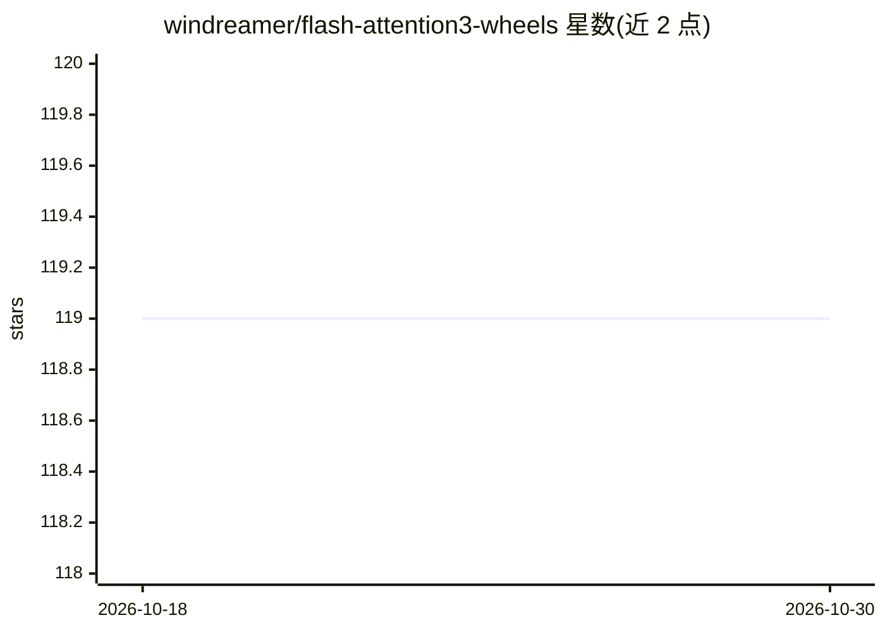

# windreamer/flash-attention3-wheels

⭐ 119 · Python · Apache-2.0 · 推送 2026-10-26 · [GitHub](https://github.com/windreamer/flash-attention3-wheels) · [官网](https://windreamer.github.io/flash-attention3-wheels/) · 个人维护

**Flash Attention 3 预编译 wheel 下载源，免去本地编译**

为 Dao-AILab flash-attention 3 提供预构建 Python wheel 与 GitHub Pages 索引：覆盖 Linux、Windows 及 Arm CUDA SBSA 平台（如 GH200），按 CUDA 12.8/13.0/13.2 与 PyTorch 版本组合分发。用户通过 pip --find-links 选择匹配索引直接安装，无需本地编译。构建脚本从上游仓库克隆源码，每两周（第 2、4 个周日）及按需手动触发更新，release 以构建日期标记。Windows 兼容性修复已提交上游 PR #2047。

## 筛选速览

| 维度 | 判定 | 备注 |
|---|---|---|
| AI 角色 | `ai-ecosystem` | LLM/agent 周边工具 |
| 许可风险 | `permissive` | Apache-2.0 |
| 部署形态 | `library` | 以包/库形式分发 |
| 模型依赖 | — | README 未给出锁定关系 |
| 硬件要求 | — | 无带数字的原话,不猜 |
| 安装摩擦 | `medium` | 含编译或系统依赖之一 |
| 成熟度 | — | 结构信号不足 |

## 能力要点

- 覆盖 Windows、Linux 与 Arm CUDA SBSA（GH200）平台的预编译 wheel
- 按 CUDA 12.8/13.0/13.2 与 PyTorch 版本组合提供索引
- 双周定期构建并支持手动触发，release 以构建日期标记
- Windows 兼容性修复已提交上游 PR #2047

## 适用场景

- 免去 Flash Attention 3 源码编译，直接 pip 安装
- 在 Windows 或 GH200 等 Arm 平台上使用 Flash Attention 3
- 按 CUDA/PyTorch 版本组合快速匹配可用 wheel

## 场景标签

 · 领域:AI 基础设施/软件分发

## 证据(README 行号)

> L3: **Pre-built wheels that erase Flash Attention 3 installation headaches — now with Windows & Arm support! 🎉**
> L31:   --find-links https://windreamer.github.io/flash-attention3-wheels/cu128_torch280

## 星数曲线

2026-10-18 119 → 2026-10-30 119（+0）

---
*卡片 v1 · prompt 1.4 · 生成 2026-10-23 · 置信度 high · 依据 README sha `eabcebe291b4` · [字段定义](../../DATASET.md)*
