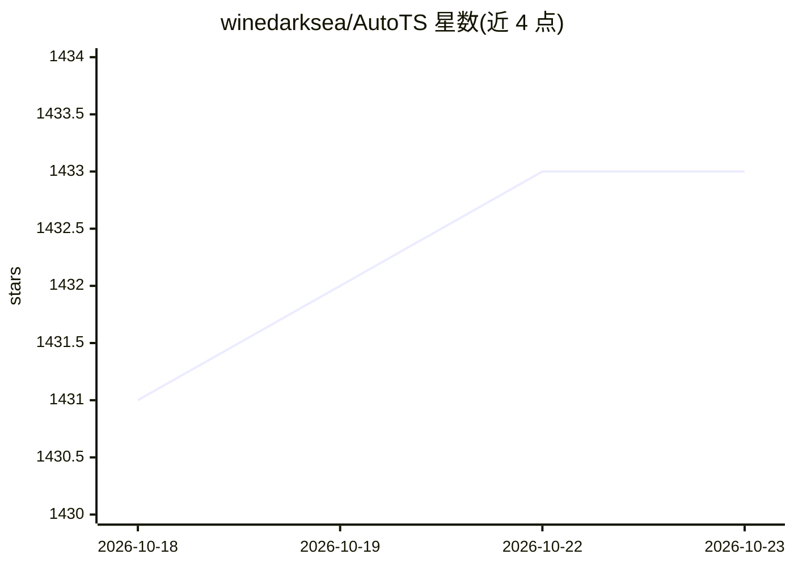

# winedarksea/AutoTS

⭐ 1,433 · Python · MIT · 推送 2026-10-15 · [GitHub](https://github.com/winedarksea/AutoTS) · 个人维护

**面向 Python 的自动化时间序列预测库，AutoML 搜索最优模型**

Python 时间序列预测包，提供数十个 sklearn 风格（.fit()/.predict()）的预测模型与 30 余个时序变换器，直接作用于 Pandas DataFrame；通过遗传算法自动搜索最佳模型、预处理与集成方案（含 horizontal/mosaic 集成），支持多序列、概率区间预测、外生回归变量与模板导入导出。附带 MCP Server 可选安装（pip install autots[mcp]），供 agent 调用。作者为个人开发者，曾在 M6 预测竞赛获胜并有期刊论文。

## 筛选速览

| 维度 | 判定 | 备注 |
|---|---|---|
| AI 角色 | `ai-native` | 本体是模型或模型工具 |
| 许可风险 | `permissive` | MIT |
| 部署形态 | `library` | 以包/库形式分发 |
| 模型依赖 | — | README 未给出锁定关系 |
| 硬件要求 | — | 无带数字的原话,不猜 |
| 安装摩擦 | `low` | 无编译、无系统依赖或容器化 |
| 成熟度 | — | 结构信号不足 |

## 能力要点

- 数十个 naive/统计/机器学习/深度学习预测模型，sklearn 风格 API
- 遗传算法驱动的 AutoML 搜索：模型、预处理与集成自动选择
- 支持多序列输出、概率上下界预测与外生回归变量
- 提供 MCP Server（pip install autots[mcp] 或 autots-mcp）

## 适用场景

- 在大规模多序列数据上自动训练并选出合适的预测模型
- 为业务指标做带上下界的概率性时间序列预测
- 通过 MCP 让 agent 调用自动化预测流程

## 场景标签

 · 领域:机器学习/时间序列预测

## 证据(README 行号)

> L3: AutoTS is a time series package for Python designed for rapidly deploying high-accuracy forecasts at scale. Give it 
> L7: There are dozens of forecasting models usable in the `sklearn` style of `.fit()` and `.predict()`.
> L16: These models are all designed for integration in an AutoML feature search which automatically finds the best models

## 星数曲线

2026-10-18 1,431 → 2026-10-23 1,433（+2）

---
*卡片 v1 · prompt 1.4 · 生成 2026-10-21 · 置信度 high · 依据 README sha `89aa477711f6` · [字段定义](../../DATASET.md)*
