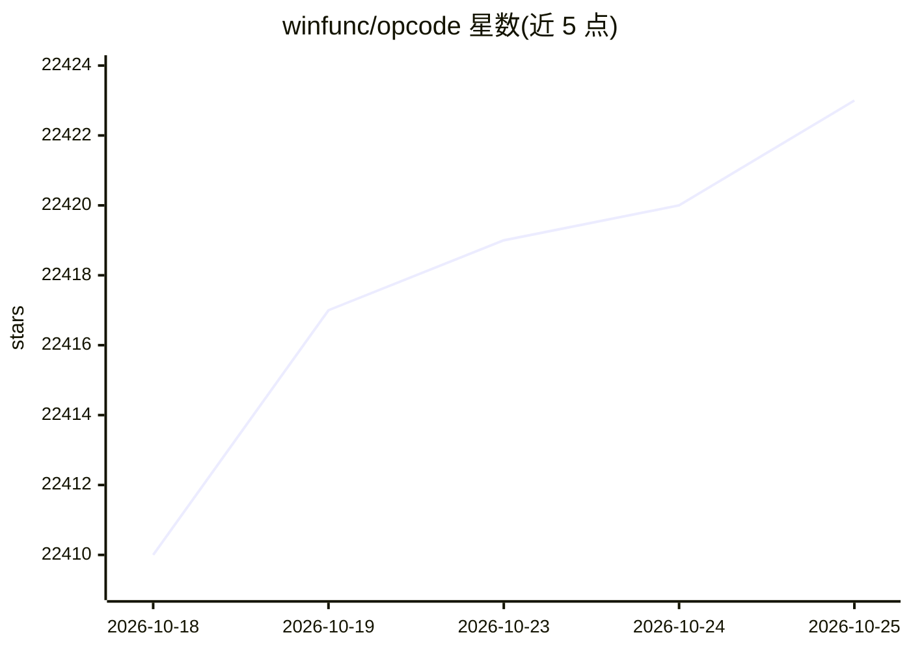

# winfunc/opcode

⭐ 22,419 · TypeScript · AGPL-3.0 · 推送 2026-09-18 · [GitHub](https://github.com/winfunc/opcode) · [官网](https://opcode.sh) · 个人维护

**给 Claude Code 用户的桌面 GUI：管理会话、自建 agent 与用量**

基于 Tauri 2 的桌面应用，为 Claude Code CLI 提供图形界面：浏览 ~/.claude/projects 下的项目与会话并恢复历史、创建带自定义系统提示词与权限的 CC Agents 并在独立进程后台运行、集中管理 MCP 服务器、会话检查点时间线与回滚、CLAUDE.md 内置编辑器、用量与成本仪表盘。数据本地存储，无遥测；依赖 Claude Code CLI 在 PATH 中可用；AGPL 许可。README 说明发布版可执行文件尚未提供，需从源码构建。

## 筛选速览

| 维度 | 判定 | 备注 |
|---|---|---|
| AI 角色 | `ai-ecosystem` | LLM/agent 周边工具 |
| 许可风险 | `viral` | AGPL-3.0 |
| 部署形态 | `desktop` | 安装包/桌面程序 |
| 模型依赖 | locked-api |  |
| 硬件要求 | — | 无带数字的原话,不猜 |
| 安装摩擦 | `low` | 无编译、无系统依赖或容器化 |
| 成熟度 | `idea` | |

## 动量与使用信号

- 维护:`active` — 距上次 push 29.7 天,年发版 0,14 位贡献者
- 涨星:近 1 天 **-6**(自 20261016 起算)
- 平台:— · 协议:MCP

## 能力要点

- 可视化浏览与恢复 ~/.claude/projects 会话历史
- 自定义 CC Agents：系统提示词、权限配置、独立进程后台执行
- MCP 服务器集中管理，支持从 Claude Desktop 导入配置
- 会话检查点时间线、分支回滚与 diff 查看

## 适用场景

- 用图形界面管理多个 Claude Code 项目与历史会话
- 为不同任务创建可复用的专用编码 agent
- 按模型/项目/日期追踪 Claude API 用量与成本
- 统一管理 MCP 服务器配置并测试连接

## 场景标签

`编码 Agent` · 领域:编码与开发

## 证据(README 行号)

> L25: **opcode** is a powerful desktop application that transforms how you interact with Claude Code. Built with Tauri 2,
> L44: - **Custom AI Agents**: Create specialized agents with custom system prompts and behaviors
> L127: - **Claude Code CLI**: Install from Claude's official site

## 星数曲线

2026-10-18 22,410 → 2026-10-25 22,423（+13）

---
*卡片 v1 · prompt 1.4 · 生成 2026-10-18 · 置信度 high · 依据 README sha `8e9a4684b411` · [字段定义](../../DATASET.md)*
