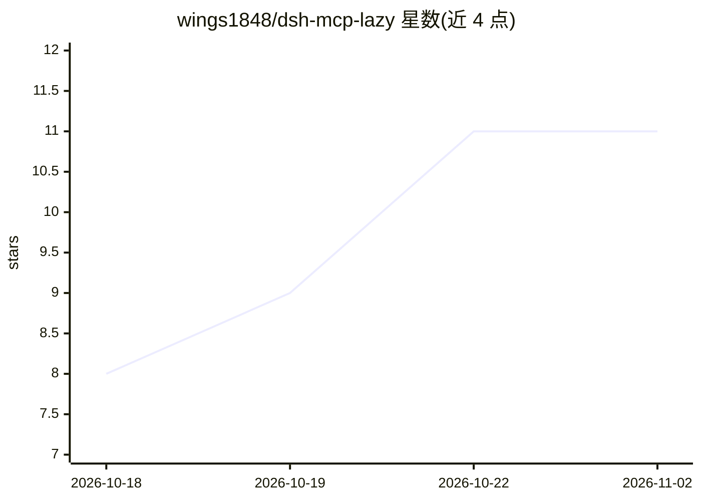

# wings1848/dsh-mcp-lazy

⭐ 11 · TypeScript · MIT · 推送 2026-11-01 · [GitHub](https://github.com/wings1848/dsh-mcp-lazy) · 个人维护 · 中文 README

**DeepSeek Harness 的惰性 MCP 网关插件：单工具代理省 token**

面向 DeepSeek Harness 的 MCP 插件：以一个固定 schema 的 mcp 工具替代 N 个原生注册的工具 schema，模型通过 search/describe 查询磁盘缓存的工具元数据，仅在真正调用时才启动对应服务器，空闲后回收。针对 chrome-devtools-mcp@1.6.0 的测量显示每请求 schema 从约 5313 token 降至 381；自带衡量脚本。提供 adopt 命令把既有 dsh-mcp-client 配置行迁移过来（带备份与干跑）。v1 边界：仅支持 tools（无 resources/prompts/OAuth）、仅 stdio 与 streamable-http 传输、不导入 Cursor/Claude Code 等外部 MCP 配置。

## 筛选速览

| 维度 | 判定 | 备注 |
|---|---|---|
| AI 角色 | `ai-ecosystem` | LLM/agent 周边工具 |
| 许可风险 | `permissive` | MIT |
| 部署形态 | `library` | 以包/库形式分发 |
| 模型依赖 | locked-api |  |
| 硬件要求 | — | 无带数字的原话,不猜 |
| 安装摩擦 | `low` | 无编译、无系统依赖或容器化 |
| 成熟度 | `idea` | |

## 能力要点

- 单一固定 schema 工具替代 N 个 MCP 工具 schema，实测省 92.8% token（29 工具场景）
- 工具元数据磁盘缓存，search/describe 不启动服务器，首次调用才 spawn
- adopt/slash 命令迁移现有 dsh-mcp-client 配置，干跑、备份、逐行报告不可安全迁移项
- 迁移计划标出 home 层禁用对其他 profile 的影响范围

## 适用场景

- MCP 服务器多、每请求 schema token 开销大的 DeepSeek Harness 用户降低成本
- 按需启动 MCP 服务器，减少常驻子进程
- 把已有原生注册的 MCP 配置批量迁移到惰性网关

## 场景标签

 · 领域:LLM 基础设施/MCP 工具网关

## 证据(README 行号)

> L9: A lazy MCP gateway for DeepSeek Harness. It puts **one**
> L18: `@deepseek-ai/dsh-mcp-client` connects every configured server at startup and registers every

## 星数曲线

2026-10-18 8 → 2026-11-02 11（+3）

---
*卡片 v1 · prompt 1.4 · 生成 2026-11-01 · 置信度 high · 依据 README sha `edee0be07fec` · [字段定义](../../DATASET.md)*
