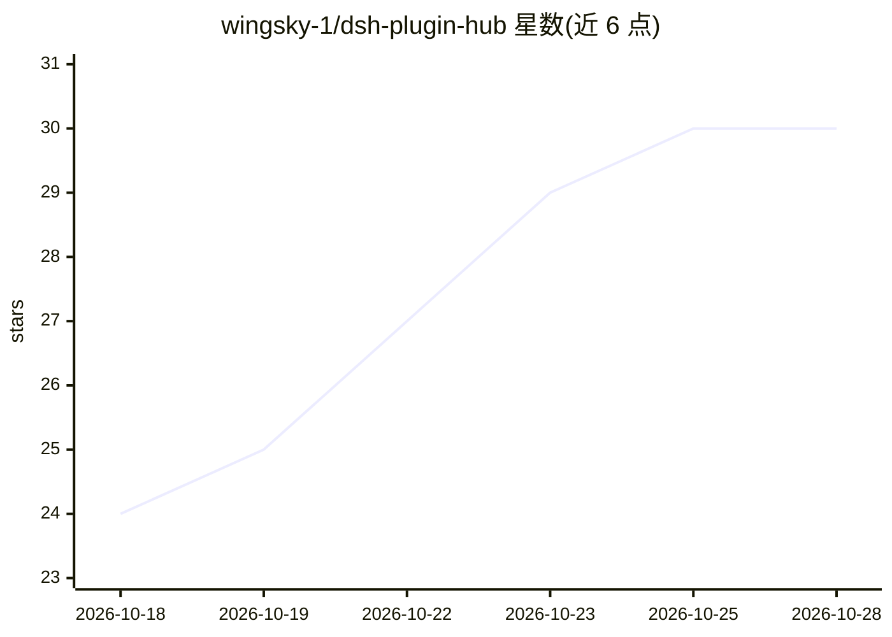

# wingsky-1/dsh-plugin-hub

⭐ 30 · TypeScript · MIT · 推送 2026-10-27 · [GitHub](https://github.com/wingsky-1/dsh-plugin-hub) · 个人维护 · 中文 README

**DeepSeek Harness Web GUI 插件集：通知/用量/局域网代理/MCP 管理/隔离验证**

面向 DSH（DeepSeek Harness）0.2.1-rc.2 的 Web GUI 插件集合，经 npm 分发，可一键安装聚合包或按需单装。包含五个在维护插件：任务事件通知（Bark/Webhook/浏览器/toast）、多 provider 用量统计框架（内置 DeepSeek 与 OpenCode 适配器）、局域网 HTTP/HTTPS/WebSocket 转发（TLS/压缩/免 token）、MCP 服务器两级配置管理（中间层收敛为 4 个原子工具）、插件开发隔离浏览器验证。仓库当前处于有限维护阶段，只适配 rc 版本，另有 7 个历史插件已停止维护并标记 deprecated。

## 筛选速览

| 维度 | 判定 | 备注 |
|---|---|---|
| AI 角色 | `ai-ecosystem` | LLM/agent 周边工具 |
| 许可风险 | `permissive` | MIT |
| 部署形态 | `library` | 以包/库形式分发 |
| 模型依赖 | locked-api |  |
| 硬件要求 | — | 无带数字的原话,不猜 |
| 安装摩擦 | `low` | 无编译、无系统依赖或容器化 |
| 成熟度 | — | 结构信号不足 |

## 能力要点

- 5 个在维护插件经 npm 分发，支持聚合包或单包安装
- MCP 中间层将全部 MCP 工具收敛为 4 个原子工具，控制上下文规模
- 多 provider 用量统计框架支持自定义适配器，密钥仅留在宿主端
- lan-proxy 默认 0.0.0.0 开放并自动注入令牌，README 给出逐插件安全边界说明

## 适用场景

- 为 DSH Web GUI 添加任务通知与手机推送
- 从手机/平板经局域网访问 dsh web UI
- 分工作空间管理 MCP 配置并控制工具上下文规模
- 在隔离环境中对 DSH 插件做浏览器验证

## 场景标签

`LLM 可观测性` · 领域:评测与运维

## 证据(README 行号)

> L19: DSH（DeepSeek Harness）Web GUI 插件集，npm 分发：一键装全家桶，或按需单装。
> L79: ## 插件列表
> L164: MCP 服务器管理器（stdio / streamable-http）：项目级/全局两级配置分工作目录维护；全部 MCP 经中间层收敛为 4 个原子工具（模型不可见 `mcp__` 直呼工具）；工作空间隔离防串台；配置只存 `$

## 星数曲线

2026-10-18 24 → 2026-10-28 30（+6）

---
*卡片 v1 · prompt 1.4 · 生成 2026-10-26 · 置信度 high · 依据 README sha `f97990d12160` · [字段定义](../../DATASET.md)*
