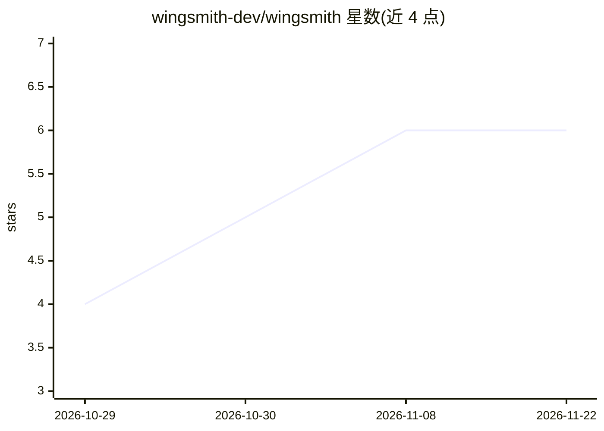

# wingsmith-dev/wingsmith

⭐ 6 · Python · Apache-2.0 · 推送 2026-11-18 · [GitHub](https://github.com/wingsmith-dev/wingsmith) · [官网](https://wingsmith.dev) · 组织维护

**跨 Kubernetes GPU 集群推理服务的多集群控制平面**

面向自建 GPU 集群的单组织运维者，管理跨多个 Kubernetes 集群的模型部署：登记集群并维护设备清单，把模型排布到集群并渲染为 NVIDIA Dynamo 部署，通过 OpenAI 兼容网关路由请求。由控制平面、集群内 operator/agent、网关、Web 控制台与 wings CLI 组成；网关在控制平面宕机时可凭缓存路由表继续服务。状态为 pre-release，未发布任何 tag、镜像或 chart，API 可能变动，无多用户角色与 SSO。

## 筛选速览

| 维度 | 判定 | 备注 |
|---|---|---|
| AI 角色 | `ai-ecosystem` | LLM/agent 周边工具 |
| 许可风险 | `permissive` | Apache-2.0 |
| 部署形态 | `library` | 以包/库形式分发 |
| 模型依赖 | local-ok | 支持本地模型 |
| 硬件要求 | — | 无带数字的原话,不猜 |
| 安装摩擦 | `low` | 无编译、无系统依赖或容器化 |
| 成熟度 | `idea` | |

## 能力要点

- 登记集群并维护 per-device 清单，模型渲染为 NVIDIA Dynamo 部署（引擎为 vLLM/SGLang/TensorRT-LLM）
- OpenAI 兼容网关经 HTTP/2 隧道路由请求，控制平面宕机时可凭缓存路由表继续服务
- operator/agent 均单向拨出（WebSocket），控制平面永不拨入集群
- 提供 web 控制台与 wings CLI 管理租户、端点、配额与 drain/scale 操作

## 适用场景

- 一个组织跨多个自建 Kubernetes GPU 集群统一部署和路由 LLM 推理
- 由单管理员或小团队集中管理租户、端点与配额
- 对 OpenAI 兼容端点做负载压测与行为一致性检查

## 场景标签

`推理引擎` · 领域:训练与推理

## 证据(README 行号)

> L15: A control plane for serving models across several Kubernetes GPU clusters. Wingsmith enrols your
> L22: Dynamo (with vLLM, SGLang or TensorRT-LLM as the engine), and that is the only serving runtime it

## 星数曲线

2026-10-29 4 → 2026-11-22 6（+2）

---
*卡片 v1 · prompt 1.4 · 生成 2026-11-20 · 置信度 high · 依据 README sha `bff5650b33fe` · [字段定义](../../DATASET.md)*
