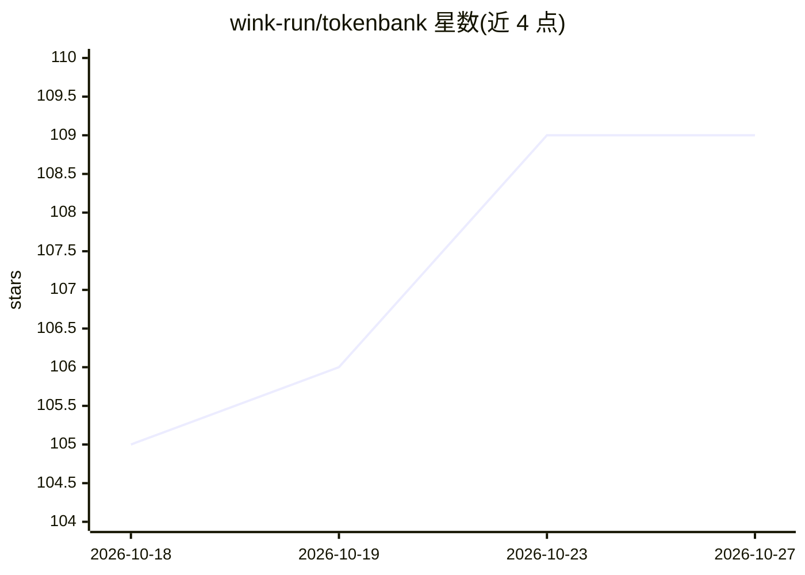

# wink-run/tokenbank

⭐ 109 · JavaScript · Apache-2.0 · 推送 2026-10-26 · [GitHub](https://github.com/wink-run/tokenbank) · [官网](https://tokenbank.wink.run) · 组织维护 · 中文 README

**本地 LLM 网关：统一接入各 AI agent 的 token 用量与智能路由**

面向个人开发者的本地 AI 资源中心：将 Claude Code、Codex、Cursor、Kimi Code 等 agent 通过本地网关统一接入，支持用量统计（实时代理 + 会话导入）、跨设备账单聚合、第三方模型透明切换（保留原生模型名，协议自动转换）、按场景/任务类型的智能路由，以及通过 P2P 算力共享网络出租闲置额度换取积分。API key 不离开本机。提供 Electron 桌面端、CLI 与 Docker Web UI 三种形态。

## 筛选速览

| 维度 | 判定 | 备注 |
|---|---|---|
| AI 角色 | `ai-ecosystem` | LLM/agent 周边工具 |
| 许可风险 | `permissive` | Apache-2.0 |
| 部署形态 | `desktop` | 安装包/桌面程序 |
| 模型依赖 | local-ok | 支持本地模型 |
| 硬件要求 | — | 无带数字的原话,不猜 |
| 安装摩擦 | `low` | 无编译、无系统依赖或容器化 |
| 成熟度 | — | 结构信号不足 |

## 能力要点

- 一键接入主流 agent（CLI env 注入 / 配置热补丁），可随时还原官方配置
- Anthropic Messages / OpenAI Chat / Codex Responses 协议透明转换
- 全链路用量追踪与多设备云端合并统计
- 本地优先 + 免费额度优先的智能路由与故障切换

## 适用场景

- 把多个 AI 编程工具接到一个本地地址统一管理
- 看清每个应用每个模型的 token 消耗与成本
- 把 Claude Code 等客户端路由到本地 Ollama 或免费 Groq 额度
- 出租闲置的模型与 agent 额度换取积分

## 场景标签

`模型网关` `LLM 可观测性` · 领域:Agent 开发

## 证据(README 行号)

> L13: **Token Bank is a next-generation personal AI resource hub** that enables one-click onboarding and intelligent orch
> L91: Token Bank is more than an API proxy — it brings **Claude Code, Codex, Cursor, WorkBuddy, Kimi Code, OpenClaw**, an
> L75: │  Desktop (Electron · Mac / Windows) or CLI / Docker Web UI      │

## 星数曲线

2026-10-18 105 → 2026-10-27 109（+4）

---
*卡片 v1 · prompt 1.4 · 生成 2026-10-23 · 置信度 mid · 依据 README sha `1fbceb2d8eaf` · [字段定义](../../DATASET.md)*
