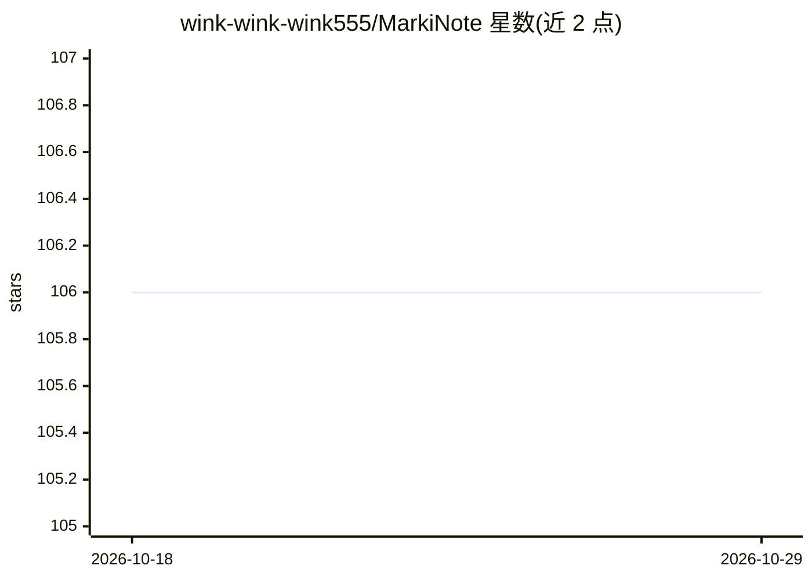

# wink-wink-wink555/MarkiNote

⭐ 106 · Python · MIT · 推送 2026-10-28 · [GitHub](https://github.com/wink-wink-wink555/MarkiNote) · 个人维护 · 中文 README

**自托管的 Markdown 写作阅读与 AI Agent 文档工作区**

将本地 Markdown 目录变为浏览器端写作、阅读与 AI 辅助知识工作区：React 19 + FastAPI 单体架构，经 NGINX 同源网关部署，支持 Docker Compose 与可选 PostgreSQL/Prometheus/OpenTelemetry 配置。内置 AI Agent 可调用 11 个有界工具读取、创建、编辑、删除、移动文件并搜索网页；写操作受选择性开启、单次审批、before-image 与操作日志保护，支持单操作回滚。模型接入限定 DeepSeek 与 Kimi 白名单。版本 4.0.0 自述为 Beta，面向单机自托管评估，非稳定生产版；轻量 Flask 版保留在 lite 分支。

## 筛选速览

| 维度 | 判定 | 备注 |
|---|---|---|
| AI 角色 | `ai-native` | 本体是模型或模型工具 |
| 许可风险 | `permissive` | MIT |
| 部署形态 | `desktop` | 安装包/桌面程序 |
| 模型依赖 | locked-api |  |
| 硬件要求 | — | 无带数字的原话,不猜 |
| 安装摩擦 | `low` | 无编译、无系统依赖或容器化 |
| 成熟度 | `idea` | |

## 能力要点

- AI Agent 拥有 11 个有界工具（读/写/网页搜索与抓取）
- 写操作受单次审批、before-image、操作日志与单操作回滚保护
- 渲染支持 Mermaid、KaTeX、语法高亮与净化 Markdown
- 四语 UI，Docker Compose 部署并附可选指标/追踪/数据库配置

## 适用场景

- 把本地 Markdown 文件目录变成带预览的网页写作阅读环境
- 让 AI Agent 代为检索、创建、编辑与整理文档并逐操作审批回滚
- 单机自托管一个可审计的 AI 辅助知识库

## 场景标签

`知识库管理` `AI 助手` · 领域:对话与助手

## 证据(README 行号)

> L17: The AI assistant is an agent rather than a chat-only sidebar: it can inspect the library, search content, create an
> L33: |AI|DeepSeek and Kimi allowlists, streaming SSE, 11 bounded tools|
> L63: |AI actions|11 tools, write opt-in, per-resource authorization, exact one-time approvals, before-images, audit reco

## 星数曲线

2026-10-18 106 → 2026-10-29 106（+0）

---
*卡片 v1 · prompt 1.4 · 生成 2026-10-23 · 置信度 high · 依据 README sha `5424dcf6e275` · [字段定义](../../DATASET.md)*
