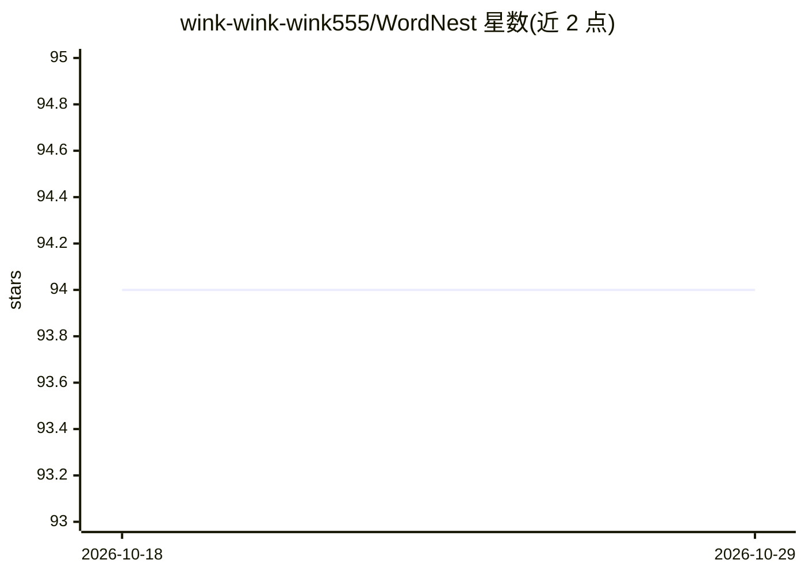

# wink-wink-wink555/WordNest

⭐ 94 · HTML · MIT · 推送 2026-05-26 · [GitHub](https://github.com/wink-wink-wink555/WordNest) · 个人维护 · 中文 README

**基于 Flask 的个人生词本 Web 应用，配 AI 例句与词汇知识图谱**

面向英语学习者的本地部署 Flask Web 应用：仅收录用户手动添加的生词，提供随机抽查、多词性释义编辑、星标重点、快捷键刷词、多单词列表与 CSV 导出。AI 为可选功能：通过 Ollama 本地运行 Qwen 模型生成例句与记忆技巧，通过 DeepSeek API 绘制词汇关联知识图谱并给出学习路径建议；未配置 API 时基础词库功能仍可使用。默认 SQLite，支持切换 PostgreSQL/MySQL，可用 Gunicorn 部署。

## 筛选速览

| 维度 | 判定 | 备注 |
|---|---|---|
| AI 角色 | `ai-enhanced` | 去掉 AI 部分产品仍成立 |
| 许可风险 | `permissive` | MIT |
| 部署形态 | `library` | 以包/库形式分发 |
| 模型依赖 | local-ok | 支持本地模型 |
| 硬件要求 | — | 无带数字的原话,不猜 |
| 安装摩擦 | `low` | 无编译、无系统依赖或容器化 |
| 成熟度 | — | 结构信号不足 |

## 能力要点

- 只收录用户手动添加的生词，支持多列表与星标管理
- Ollama + Qwen 本地生成例句与记忆技巧
- DeepSeek API 绘制词汇关联知识图谱（Beta）
- 三层架构（路由/服务/数据），支持 SQLite/PostgreSQL/MySQL

## 适用场景

- 把自己总记不住的生词集中收录并反复抽查
- 让 AI 为生词生成例句和记忆方法
- 通过知识图谱查看单词间关联和学习路径

## 场景标签

`知识图谱` · 领域:知识与检索

## 证据(README 行号)

> L35: - **专属词汇库**：只收录你自己添加的生词，告别无用功！(๑•̀ㅂ•́)و✧
> L40: - **智能例句生成**：Ollama + Qwen本地大模型，秒出地道例句 ٩(◕‿◕)۶
> L52: - **离线使用**：没网也能背单词，地铁上的学习时光不浪费

## 星数曲线

2026-10-18 94 → 2026-10-29 94（+0）

---
*卡片 v1 · prompt 1.4 · 生成 2026-10-23 · 置信度 high · 依据 README sha `f7253d1da901` · [字段定义](../../DATASET.md)*
