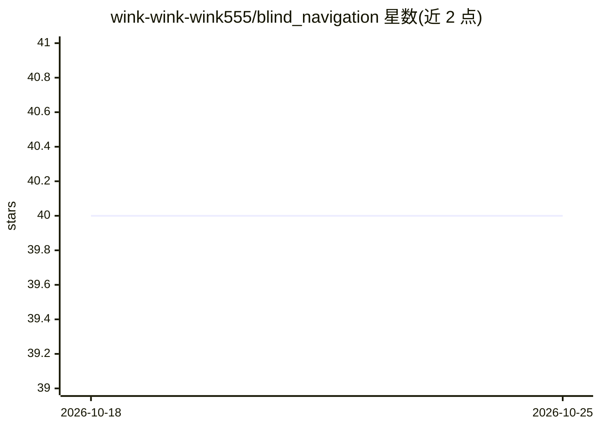

# wink-wink-wink555/blind_navigation

⭐ 40 · Python · MIT · 推送 2026-09-26 · [GitHub](https://github.com/wink-wink-wink555/blind_navigation) · 组织维护 · 中文 README

**面向视障用户的实时视觉导航与语音引导辅助系统**

ARIADNE 是为视障人士提供的辅助导航系统：百度步行路线与 GPS 提供宏观路线，YOLO 盲道检测结合近场几何估计与时间状态给出局部对齐提示，NavigationManager 融合两者经统一语音调度器（优先级/TTL/上下文失效）播报。另含多 Agent 助手（路由/地图/设置/陪伴聊天），支持 DeepSeek、OpenAI、通义千问等云端模型或本地 Ollama，并带家人账户、位置共享、语音消息、DashScope 语音识别。Flask + MySQL 后端，浏览器端运行，需配置百度地图与模型 API key。

## 筛选速览

| 维度 | 判定 | 备注 |
|---|---|---|
| AI 角色 | `ai-native` | 本体是模型或模型工具 |
| 许可风险 | `permissive` | MIT |
| 部署形态 | `library` | 以包/库形式分发 |
| 模型依赖 | local-ok | 支持本地模型 |
| 硬件要求 | — | 无带数字的原话,不猜 |
| 安装摩擦 | `low` | 无编译、无系统依赖或容器化 |
| 成熟度 | — | 结构信号不足 |

## 能力要点

- YOLO 盲道检测 + 近场几何估计 + 时间状态融合的局部对齐引导
- 六优先级统一语音调度器，支持 TTL 与上下文失效
- RouterAgent/MapAgent/SettingsAgent/ChatAgent 多 Agent 架构，MapAgent 经百度地图 MCP 查路线
- 云端（DeepSeek/OpenAI/DashScope）或本地 Ollama 模型可选，附家人位置共享与语音消息

## 适用场景

- 视障用户户外步行时获得盲道对齐与转向语音引导
- 通过自然语言向 AI 助手查路线、改设置、给家人发消息
- 家人账户查看共享位置并发送语音消息

## 场景标签

 · 领域:无障碍辅助技术/导航

## 证据(README 行号)

> L25: ARIADNE is an assistive navigation system for visually impaired users that integrates tactile-paving perception, Ba
> L39: - **AI Text Model**: server-configured cloud APIs (DeepSeek, OpenAI, DashScope/Qwen, or another OpenAI-compatible s
> L63: - 🎥 **Live Tactile-Paving Perception**: YOLO detection is combined with near-field geometry and temporal state esti

## 星数曲线

2026-10-18 40 → 2026-10-25 40（+0）

---
*卡片 v1 · prompt 1.4 · 生成 2026-10-25 · 置信度 high · 依据 README sha `bf90b1a1e416` · [字段定义](../../DATASET.md)*
