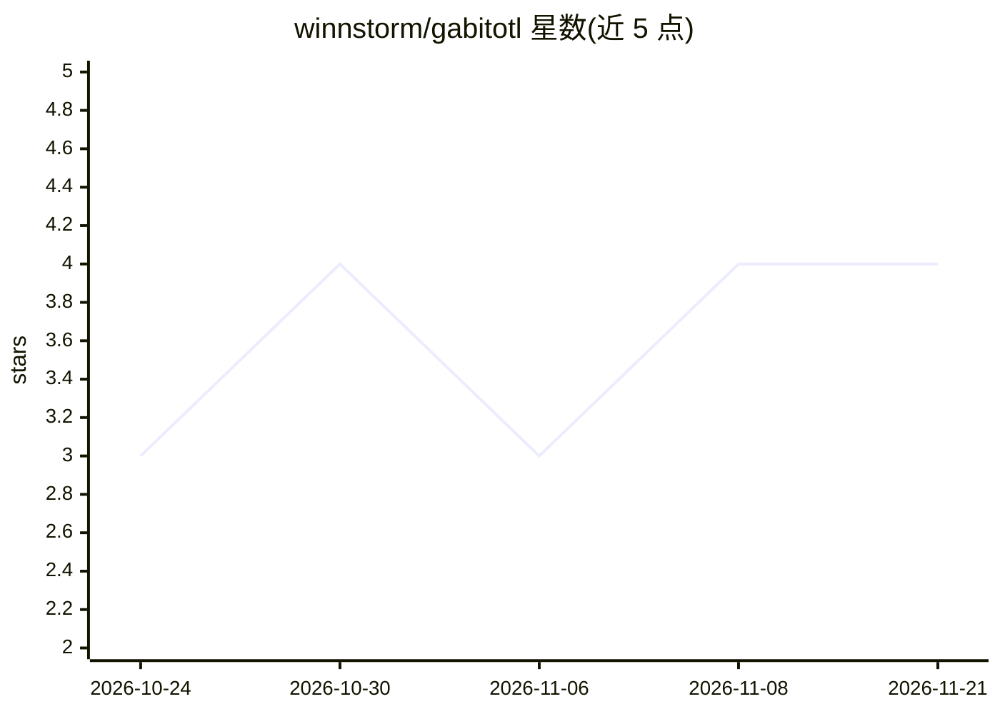

# winnstorm/gabitotl

⭐ 4 · Go · Apache-2.0 · 推送 2026-10-22 · [GitHub](https://github.com/winnstorm/gabitotl) · 个人维护

**为 Claude Code 等编码 agent 提供记忆、人格与团队协作的 Go 工具**

单二进制 Go 工具，为 Claude Code、OpenCode 和 Kiro 三种编码 agent 运行时提供外围支撑层：跨会话的项目记忆（单人用 Engram，团队用 PostgreSQL 的 Memory MCP server）、Argentina 西语/英语人格与三种聊天模式、Git 提交/推送/PR/合并的交付流程（含 stacked PRs 与按里程碑推送）、作者权守护（清除 AI 署名标记）、团队协调（who/worktree/OJO 提示）。自身不调用 LLM；8 个技能按需加载；每次修改前自动快照备份，支持 --dry-run 与只读 doctor 健康检查。需 Go 1.26 构建，Git 必需，Engram/gh 等为可选。

## 筛选速览

| 维度 | 判定 | 备注 |
|---|---|---|
| AI 角色 | `ai-ecosystem` | LLM/agent 周边工具 |
| 许可风险 | `permissive` | Apache-2.0 |
| 部署形态 | `desktop` | 安装包/桌面程序 |
| 模型依赖 | — | README 未给出锁定关系 |
| 硬件要求 | — | 无带数字的原话,不猜 |
| 安装摩擦 | `low` | 无编译、无系统依赖或容器化 |
| 成熟度 | — | 结构信号不足 |

## 能力要点

- 单 Go 二进制，无额外运行时；提供预编译 Linux/macOS/Windows 安装包
- 项目记忆双提供者：Engram（单人）或 PostgreSQL 团队 Memory MCP server，按项目选择
- Git 交付：commit/push/PR/merge，超 400 行自动拆分 stacked PRs
- 75% 上下文规则、run 摘要与缓存等 token 节省机制

## 适用场景

- 让编码 agent 在多次会话间保留项目工作记忆
- 团队多人用 agent 开发同一项目时的协调与记忆共享
- 规范 agent 的 Git 提交与 PR 交付流程并保留作者权

## 场景标签

`Agent 记忆` · 领域:Agent 开发

## 证据(README 行号)

> L27: GabitoTL is **not an LLM and does not call one**. It is the layer around the agent you already use, so a project
> L3:  A single Go binary that gives Claude Code, OpenCode and Kiro a persona, a project memory, Git discipline and team c
> L54: One Core, with thin adapters per runtime. Only adapters know a runtime's file formats; the Core never branches on

## 星数曲线

2026-10-24 3 → 2026-11-21 4（+1）

---
*卡片 v1 · prompt 1.4 · 生成 2026-11-21 · 置信度 high · 依据 README sha `0e5d8e17e68c` · [字段定义](../../DATASET.md)*
