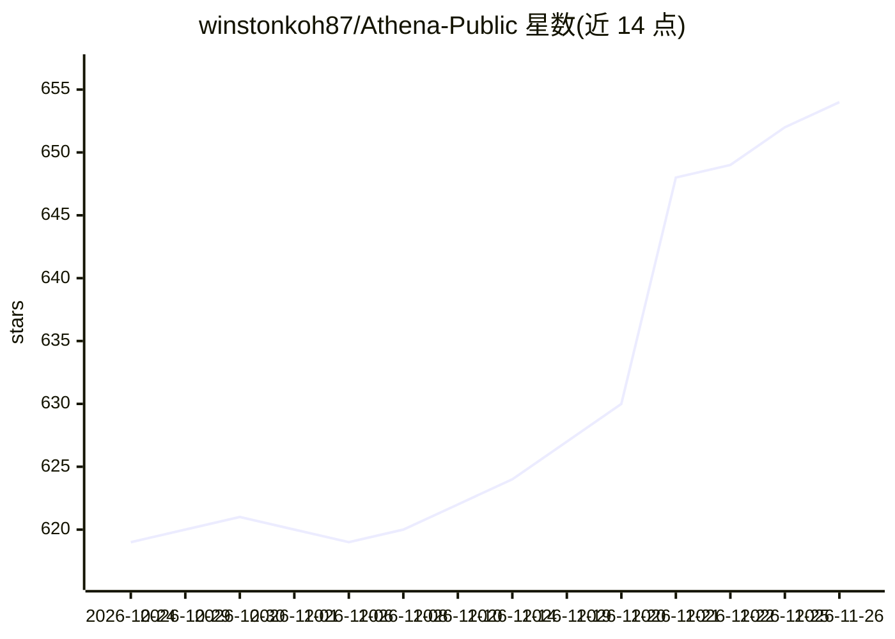

# winstonkoh87/Athena-Public

⭐ 654 · Python · MIT · 推送 2026-11-25 · [GitHub](https://github.com/winstonkoh87/Athena-Public) · [官网](https://winstonkoh87.com/athena/) · 个人维护

**为 AI 编码代理提供本地持久记忆与治理层的工具**

Athena 为 Claude Code、Antigravity、Cursor、Gemini CLI、VS Code 等 IDE 中的 AI 代理提供本地优先的持久记忆、结构化问题框架与治理钩子：状态以 Markdown/JSONL/SQLite 存储在用户磁盘并由 git 管理，通过 /start 与 /end 命令恢复和保存会话状态；SDK 含两个 MCP 服务器，提供混合检索（BM25 FTS5 + 向量 + ONNX 重排）、记忆生命周期管理（TTL、taint、遗忘）、MCDA 决策筛选与对抗推演引擎，以及阻止破坏性命令的 PreToolUse 钩子。以 Python 包安装，本地模式无需云 API key。

## 筛选速览

| 维度 | 判定 | 备注 |
|---|---|---|
| AI 角色 | `ai-ecosystem` | LLM/agent 周边工具 |
| 许可风险 | `permissive` | MIT |
| 部署形态 | `library` | 以包/库形式分发 |
| 模型依赖 | — | README 未给出锁定关系 |
| 硬件要求 | — | 无带数字的原话,不猜 |
| 安装摩擦 | `low` | 无编译、无系统依赖或容器化 |
| 成熟度 | — | 结构信号不足 |

## 能力要点

- 状态以本地 Markdown/JSONL/SQLite 存储并跨 IDE 移植
- 混合 RAG：5 通道 RRF 融合 + ONNX mini-batch 重排
- 两个 MCP 服务器与 Python SDK（决策引擎、记忆治理、本地 SQL）
- fail-closed 钩子阻断破坏性命令与秘密泄露

## 适用场景

- 让跨会话的编码代理记住架构决策与既往复盘
- 对高风险决策运行 MCDA 筛选与红蓝对抗推演
- 在多个 IDE/模型之间迁移代理状态

## 场景标签

`RAG` `Agent 记忆` · 领域:Agent 开发

## 证据(README 行号)

> L3: **Local-first memory, decision engine, and governance harness for AI agents — portable across any IDE.**
> L34: Athena moves the **memory, problem-framing, and decision layer to your machine**: plain Markdown and JSONL ledgers 
> L81: Athena is not just a prompt pack — it ships executable Python engines and two Model Context Protocol (MCP) servers 

## 星数曲线

2026-10-24 619 → 2026-11-26 654（+35）

---
*卡片 v1 · prompt 1.4 · 生成 2026-11-26 · 置信度 high · 依据 README sha `333791f031d2` · [字段定义](../../DATASET.md)*
