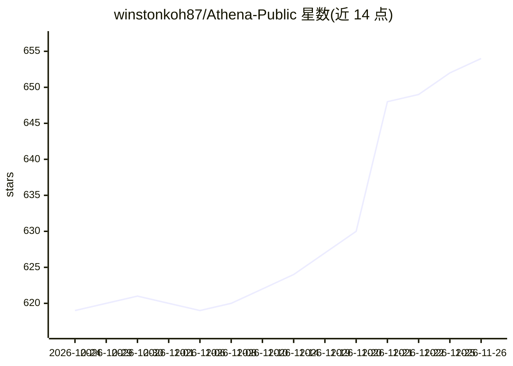

# winstonkoh87/Athena-Public

⭐ 654 · Python · MIT · 推送 2026-11-25 · [GitHub](https://github.com/winstonkoh87/Athena-Public) · [官网](https://winstonkoh87.com/athena/) · 个人维护

**为 IDE 中的 AI agent 提供本地持久记忆与治理层**

Athena 是一个运行于 Claude Code、Antigravity、Cursor、Gemini CLI、VS Code 等 IDE AI 面板的本地优先工具：将 agent 的记忆、问题框架与决策层以 Markdown/JSONL/SQLite 形式存储在用户磁盘并可 git 版本化。提供 /start、/end 生命周期命令恢复会话上下文，SDK 内含两个 MCP 服务器、混合 RAG 检索（BM25 FTS5+pgvector+RRF 融合+ONNX 重排）、量化决策引擎与 PreToolUse 治理钩子。提供 PyPI 安装及免代码三文件方案供纯网页聊天使用；README 以 Epistemic Status 表标注各机制实现程度，部分能力为 partial。

## 筛选速览

| 维度 | 判定 | 备注 |
|---|---|---|
| AI 角色 | `ai-ecosystem` | LLM/agent 周边工具 |
| 许可风险 | `permissive` | MIT |
| 部署形态 | `library` | 以包/库形式分发 |
| 模型依赖 | local-ok | 支持本地模型 |
| 硬件要求 | — | 无带数字的原话,不猜 |
| 安装摩擦 | `low` | 无编译、无系统依赖或容器化 |
| 成熟度 | — | 结构信号不足 |

## 能力要点

- 本地 Markdown/JSONL 记忆跨 Claude Code/Antigravity/Cursor/VS Code 便携
- 5 通道 RRF 混合检索与 ONNX mini-batch 重排（local/auto/always 路由）
- MCDA 决策筛选、1/3 Kelly、蒙特卡洛与 SHA-256 决策收据
- fail-closed PreToolUse 钩子拦截破坏性命令、secrets 与污染记忆写入

## 适用场景

- 在 IDE 的 AI 编码助手中跨会话延续项目记忆与不变量
- 对高风险决策做量化筛选与红蓝对抗推演
- 将 agent 状态留在本地磁盘并可在不同模型间切换

## 场景标签

`RAG` `Agent 记忆` · 领域:Agent 开发

## 证据(README 行号)

> L3: **Local-first memory, decision engine, and governance harness for AI agents — portable across any IDE.**
> L34: Athena moves the **memory, problem-framing, and decision layer to your machine**: plain Markdown and JSONL ledgers 
> L74: ├── src/athena/          # Core runtime (Memory, Intelligence/GTO, Governance, Lifecycle, Tools)

## 星数曲线

2026-10-24 619 → 2026-11-26 654（+35）

---
*卡片 v1 · prompt 1.4 · 生成 2026-11-25 · 置信度 high · 依据 README sha `2824f478c42e` · [字段定义](../../DATASET.md)*
