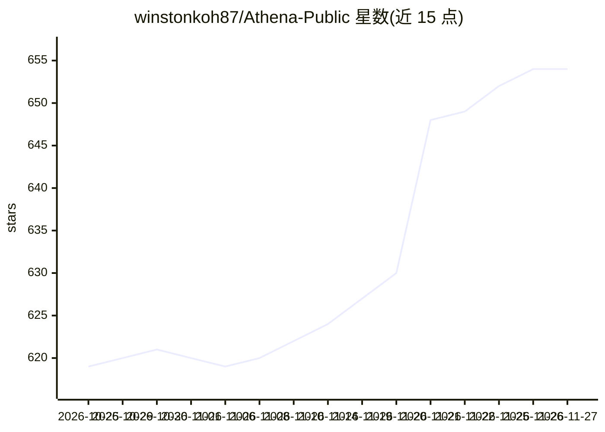

# winstonkoh87/Athena-Public

⭐ 654 · Python · MIT · 推送 2026-11-26 · [GitHub](https://github.com/winstonkoh87/Athena-Public) · [官网](https://winstonkoh87.com/athena/) · 个人维护

**给 AI 编码代理提供本地持久记忆与决策治理的框架**

Athena 将无状态 LLM 的记忆与状态层移到用户本地磁盘：以 Markdown/JSONL/SQLite 存储，通过 /start、/end 等斜杠命令在会话间恢复任务与不变量，配合 5 通道 RRF 混合检索、ONNX 重排序与上下文门控。它以 Python SDK 形式提供，含两个 MCP 服务器，可挂载到 Claude Code、Antigravity、Cursor、Gemini CLI、VS Code 等环境，另附量化决策筛选、对抗推演与 fail-closed 钩子治理；无云端 API key 也可本地安装运行。

## 筛选速览

| 维度 | 判定 | 备注 |
|---|---|---|
| AI 角色 | `ai-ecosystem` | LLM/agent 周边工具 |
| 许可风险 | `permissive` | MIT |
| 部署形态 | `library` | 以包/库形式分发 |
| 模型依赖 | — | README 未给出锁定关系 |
| 硬件要求 | — | 无带数字的原话,不猜 |
| 安装摩擦 | `low` | 无编译、无系统依赖或容器化 |
| 成熟度 | — | 结构信号不足 |

## 能力要点

- 本地优先持久记忆：Markdown/JSONL/SQLite 文件，可 git 版本管理并在 IDE 间移植
- 5 通道 RRF 混合检索（BM25 FTS5 + pgvector 等）与 ONNX 批量重排序
- 两个 MCP 服务器（athena.mcp_server 与 duckdb_mcp_server）
- fail-closed PreToolUse 钩子拦截破坏性命令、secrets 与污染记忆写入

## 适用场景

- 在 Claude Code/Cursor 等 IDE 中让代理跨会话记住架构决策与不变量
- 为高风险决策提供量化筛选、校准与对抗推演记录
- 本地化存储代理记忆，避免云数据库锁定

## 场景标签

`Agent 记忆` `RAG` · 领域:Agent 开发

## 证据(README 行号)

> L3: **Local-first memory, decision engine, and governance harness for AI agents — portable across any IDE.**

## 星数曲线

2026-10-25 619 → 2026-11-27 654（+35）

---
*卡片 v1 · prompt 1.4 · 生成 2026-11-27 · 置信度 high · 依据 README sha `5169684eb1a6` · [字段定义](../../DATASET.md)*
