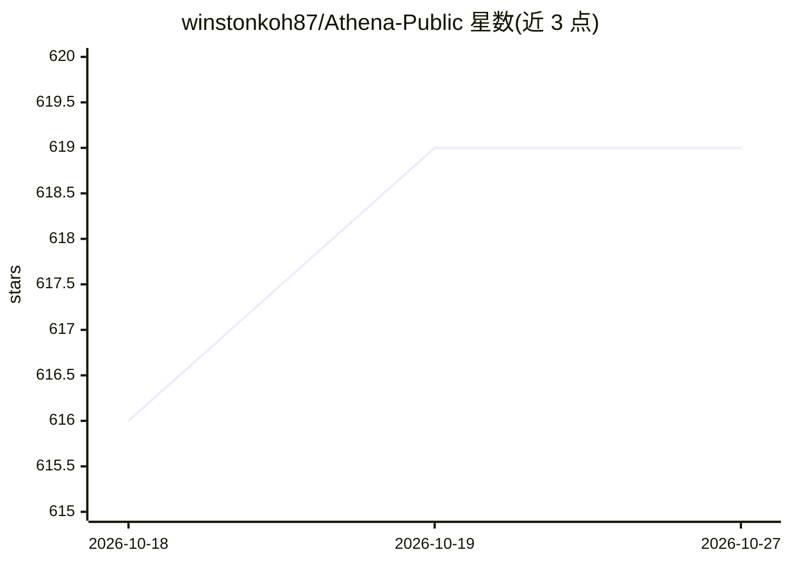

# winstonkoh87/Athena-Public

⭐ 619 · Python · MIT · 推送 2026-10-26 · [GitHub](https://github.com/winstonkoh87/Athena-Public) · [官网](https://winstonkoh87.com/athena/) · 个人维护

**本地优先的 AI agent 记忆/决策/治理框架，跨 IDE 便携**

面向开发者的 AI agent 状态管理层：把持久记忆、问题框架与量化决策引擎放在用户本地，以 Markdown 与 JSONL 文件存储，可 git 版本化并挂载到 Claude Code、Cursor、Gemini CLI 等多种 IDE。核心组件包括两个 MCP 服务器（混合 RAG 检索与 DuckDB SQL 分析）、VOI 停止规则与 R1–R13 承诺门的框架账本、EEV/Kelly/Ruin 等决策评估器（输出 SHA-256 回执），以及拦截破坏性命令与密钥外泄的治理钩子。README 用状态表区分 code-enforced 与 agent-discretion 机制，个性化效果仅有 N=1 证据。

## 筛选速览

| 维度 | 判定 | 备注 |
|---|---|---|
| AI 角色 | `ai-ecosystem` | LLM/agent 周边工具 |
| 许可风险 | `permissive` | MIT |
| 部署形态 | `library` | 以包/库形式分发 |
| 模型依赖 | — | README 未给出锁定关系 |
| 硬件要求 | — | 无带数字的原话,不猜 |
| 安装摩擦 | `low` | 无编译、无系统依赖或容器化 |
| 成熟度 | — | 结构信号不足 |

## 能力要点

- 记忆以 Markdown/JSONL 本地存储，可跨模型与 IDE 迁移
- 两个 MCP 服务器：混合 RAG（BM25+pgvector+cross-encoder）与 DuckDB 本地 SQL
- 量化决策引擎输出 SHA-256 回执（EEV、Kelly、Ruin、MCDA 等）
- 治理钩子拦截 14/16 破坏性命令与密钥外泄

## 适用场景

- 在多个 IDE/模型间保留 AI agent 的持久记忆与个性化状态
- 为高风险决策加量化评估与可审计回执
- 对 agent 运行做权限门控与破坏性命令拦截

## 场景标签

`Agent 记忆` `数据分析` · 领域:Agent 开发

## 证据(README 行号)

> L3: **A local-first memory, decision engine, and governance harness for AI agents — portable across IDEs.**
> L58: Athena is not just a prompt pack — it ships executable Python engines and two Model Context Protocol (MCP) servers 
> L62: |**Hybrid RAG & Context Gate**|`mcp_server.py` (`smart_search`, `context_gate`)|Document-level RRF fusion across BM

## 星数曲线

2026-10-18 616 → 2026-10-27 619（+3）

---
*卡片 v1 · prompt 1.4 · 生成 2026-10-21 · 置信度 high · 依据 README sha `ccd828504718` · [字段定义](../../DATASET.md)*
