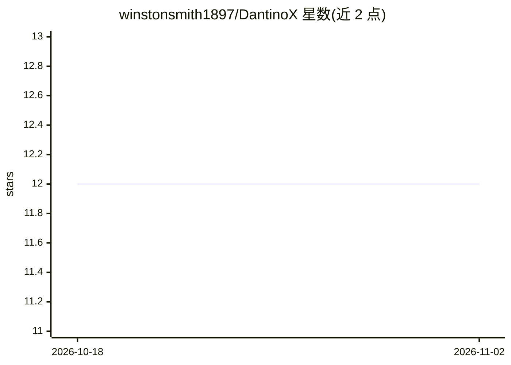

# winstonsmith1897/DantinoX

⭐ 12 · Python · MIT · 推送 2026-07-16 · [GitHub](https://github.com/winstonsmith1897/DantinoX) · [官网](https://dantinox.readthedocs.io/en/latest/) · 组织维护

**统一 AR/扩散/流匹配三范式的 JAX Transformer 研究库**

JAX/Flax NNX 实现的 Transformer 训练与生成库：将模型骨干（MHA/GQA/MLA 注意力、Dense/MoE/LatentMoE 前馈、RoPE 等）与生成范式解耦，自回归、掩码离散扩散（LLaDA）、连续流匹配（ELF）三种范式通过单一配置字段切换，权重、分词器与训练循环保持一致，用于受控的跨范式对比研究。提供统一 CLI（14 个子命令）、三层 API、LoRA 微调、多 GPU SPMD 并行与基准测试套件。面向做范式/注意力消融的研究者、教学者与需要架构变体的从业者。以 pip 包分发，MIT 许可。限制：流匹配范式暂不支持前缀/条件生成；未识别的关键字参数会被静默忽略。

## 筛选速览

| 维度 | 判定 | 备注 |
|---|---|---|
| AI 角色 | `ai-native` | 本体是模型或模型工具 |
| 许可风险 | `permissive` | MIT |
| 部署形态 | `library` | 以包/库形式分发 |
| 模型依赖 | — | README 未给出锁定关系 |
| 硬件要求 | `cpu-ok` | |
| 安装摩擦 | `high` | 编译与系统依赖俱全 |
| 成熟度 | — | 结构信号不足 |

## 能力要点

- AR/掩码扩散/连续流匹配三范式单配置字段切换，权重与训练循环一致
- MHA/GQA/MLA 注意力、Sparse MoE/LatentMoE、LoRA 微调、多 GPU DP×TP 分片均为配置标志
- 统一 CLI 含 14 个子命令（train/generate/benchmark/profile/sweep 等）
- 内置 BenchmarkSuite：吞吐/延迟/困惑度、零执行 FLOPs 计数与 MFU 剖析

## 适用场景

- 在同一代码库内对 AR、离散扩散、流匹配三种生成范式做受控消融实验
- 教学或学习覆盖三种范式的单一可读 Transformer 实现
- 复现论文的生成质量与推理效率评测流水线
- 用 GQA/MoE/LoRA 等架构变体训练语言模型而不改训练代码

## 场景标签

`微调` `模型训练` · 领域:训练与推理

## 证据(README 行号)

> L5: A research-grade JAX/Flax NNX transformer library for **autoregressive (AR)**,
> L59: method*. Selecting a paradigm — AR, masked discrete diffusion (LLaDA), or
> L60: continuous flow-matching (ELF) — is a single configuration field; the
> L65: DantinoX targets **researchers** running controlled paradigm/attention

## 星数曲线

2026-10-18 12 → 2026-11-02 12（+0）

---
*卡片 v1 · prompt 1.4 · 生成 2026-11-01 · 置信度 high · 依据 README sha `f2e1810ebe1f` · [字段定义](../../DATASET.md)*
